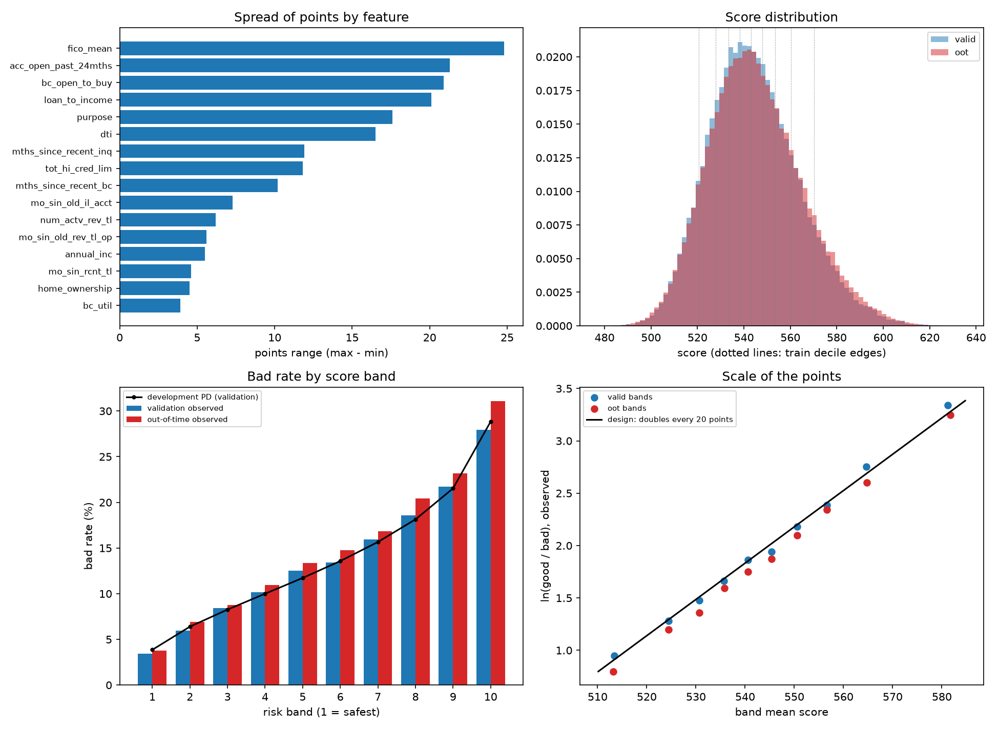

# Probability of Default (PD) Scorecard on Lending Club Data

An end-to-end retail credit-risk project: a probability-of-default scorecard built from raw Lending Club loan data (2007-2018) and taken through the stages a bank model-development and validation team would expect. Target and sample design, leakage audit, missing-data treatment, weight-of-evidence (WoE) binning, variable selection, a logistic-regression scorecard, challenger models, validation tests, stress scenarios and points scaling.

It is a portfolio project on public data. It is not a production credit model, and its numbers say nothing about any lender's current book.

**Status:** version 1 of the scorecard is frozen and fully documented. A developer's validation report ([docs/validation_report.md](docs/validation_report.md)) summarises the tests, findings and proposed monitoring.

## Headline results

| Measure | Result |
|---|---|
| Development sample | 568,694 loans (36-month term, issued Jan 2013 to Jan 2016); 14.10% went bad |
| Split | Train 307,025; validation 76,757 (same window, random); out-of-time 184,912 (Jul 2015 to Jan 2016) |
| Model | Logistic regression on 16 WoE-binned features, converted to a points scorecard |
| AUC: train / validation / out-of-time | 0.671 / 0.671 / 0.679 |
| KS: validation / out-of-time | 0.246 / 0.256 |
| Gini, out-of-time | 0.358 |
| Lender's own interest rate (deliberately not a model input) | AUC 0.656 on validation, 0.683 out-of-time |
| Best challenger (XGBoost with monotone constraints) | +0.0078 AUC on validation, +0.0055 out-of-time |
| Policy view: reject the riskiest 20% | Captures 36.0% of bad loans; bad rate among approved loans 11.0% against 13.8% overall (validation) |
| Calibration out-of-time | Observed/expected 1.086 before recalibration; 1.044 on the Oct 2015 to Jan 2016 test window after an intercept shift (target band 0.95 to 1.05) |
| Stress test | Four adverse shocks together raise mean PD by 3.06 percentage points and the rejection rate at a fixed threshold from 20.0% to 33.4% |

An AUC near 0.68 is modest, which is what application-time data gives once the lender's own grade and rate are excluded. Measured against the lender's interest rate, the scorecard is ahead of it by 0.014 AUC on validation and behind it by 0.004 out-of-time.


## Design decisions worth a reviewer's attention

1. **Sample design that avoids survivorship bias.** A loan still being repaid cannot be labelled good or bad. Only loans whose full term had elapsed by the data snapshot are kept, which gives a bad rate of 14.8% in the maturity-filtered sample; a naive "all resolved loans" sample would have shown about 21.2%. The sample is then scoped to 36-month loans issued from 2013, because several bureau fields did not exist earlier and 60-month loans cannot be validated out-of-time (decision log Sections 4, 7 and 8).
2. **Leakage audit.** All 151 raw columns were classified. 38 post-origination columns (payment history, recoveries, hardship and settlement fields) are excluded. The lender's grade, sub-grade and interest rate stay out of the model and serve only as a benchmark. A feature built from the instalment (payment to income) was also removed, because instalment divided by loan amount tracks the interest rate (correlation 0.9989); excluding it costs about 0.002 AUC.
3. **Fair-lending screen.** Zip code and state are excluded, and employment length was dropped at a cost of about 0.002 AUC because it may stand in for age or retirement. The dataset has no protected-class attributes, so a disparate-impact test could not be run, and that is stated as a limitation.
4. **Rules written before results.** Each step records its rules and expectations first, and the log records where the expectations were wrong. Out-of-time data was not used to select features, bins or hyper-parameters. One decision (dropping employment length) was made after an out-of-time ablation had been seen, and the log says so.
5. **An interpretable model checked against stronger ones.** XGBoost with monotone constraints is ahead by 0.0055 AUC out-of-time and a random forest is no better; both comparisons use a paired bootstrap. The scorecard stays the primary model because the gap is small and every bin and coefficient can be audited.
6. **Verification built in.** The scorecard card (models/scorecard_points.json) re-scores all 261,669 held-out loans exactly without the modelling code. Scripts assert their inputs against numbers from earlier stages, and a bootstrap shows that all 16 coefficients keep their sign in every resample.

## Findings that surprised me

- **The calibration drift is a vintage trend, not a step at the out-of-time boundary.** Observed/expected runs from about 0.91 for loans issued in late 2013 to 1.13 in early 2016 while the score distribution barely moves. An intercept shift fixes the average for about three months, so it needs refitting regularly or a monitoring trigger.
- **A less constrained XGBoost is about 0.011 AUC ahead out-of-time.** Its extra signal sits in shapes such as a rise in risk in the top income decile. Calibration checks on held-out loans show the scorecard does under-predict that segment, but there is no economic rationale for it, so the monotone model stays.
- **Simple capacity-ratio features did not close the gap.** None of four candidate features met pre-set criteria.
- **Rounding points to integers biases the score.** It raises mean PD by 0.31 percentage points, so the published card uses one-decimal points.

## Limitations

- Accepted loans only, so the model describes the accepted population and no reject inference was done.
- The bad label is almost entirely "charged off" (99.8% of bad loans), which comes after 90 days past due, and it covers the whole 36-month life and not a 12-month horizon. Against a Basel-style definition the bad rate is probably understated.
- The data cover 2013 to 2016, a benign credit period. PDs are point-in-time for that window and no downturn was observed.
- Calibration drifts with the vintage. The intercept shift is a stop-gap and the deployment shift is untested.
- Under-predicted segments (top income decile, extremes of bankcard utilisation, three loan purposes) are documented and carried forward, not fixed.
- The out-of-time set supplied the recalibration shift, so it is not untouched data.
- No LGD or EAD, no 12-month PD conversion and no deployment code.


## Pipeline

| Stage | Scripts | Decision log sections |
|---|---|---|
| Raw inspection, missingness, target, maturity filter | 01-06 | 1-5 |
| Leakage audit, in-sample missingness | 07-09 | 6-7 |
| Development sample, split, feature engineering | 10-12 | 8-10 |
| WoE and information-value binning (src/woe.py) | 13 | 11 |
| Label, excluded-loan and fair-lending checks | 14 | 12 |
| Variable selection | 15 | 13 |
| Scorecard, ablations, calibration | 16 | 14 |
| Final model and recalibration | 17 | 15 |
| Challenger models, SHAP | 18-19 | 16-17 |
| Segment calibration, capacity-ratio candidates | 20 | 18 |
| Validation suite on the frozen model | 21 | 19 |
| Scenario and sensitivity tests | 22 | 20 |
| Points scaling | 23 | 21 |



## Repository structure

```
.
|-- README.md
|-- requirements.txt
|-- data/
|   |-- raw/           not tracked; see data/raw/README.md
|   `-- processed/     small id and target files tracked; large derived files are regenerated by the scripts
|-- docs/
|   `-- methodology.md decision log: rules, expectations, results and an audit table
|-- models/            WoE bin specification, scorecard coefficients, points card, selected features, challenger settings
|-- notebooks/         numbered pipeline scripts 01-23
|-- reports/           tables and figures written by the scripts (plots in reports/figures/)
`-- src/
    `-- woe.py         WoE binning module: fit on train, apply anywhere
```

## Reproducing the results

Python 3.12. From the repository root:

```bash
git clone https://github.com/SoumikDash7/pd-credit-risk-model.git
cd pd-credit-risk-model
python -m venv venv
venv\Scripts\Activate.ps1        # Windows PowerShell; on macOS/Linux: source venv/bin/activate
pip install -r requirements.txt
kaggle datasets download -d wordsforthewise/lending-club -p data/raw/
```

The download needs a Kaggle API token. Unzip it, keep accepted_2007_to_2018Q4.csv.gz in data/raw/ and delete the rest (the rejected-loans file is not used). Then run notebooks/01_raw_inspection.py through notebooks/23_scorecard_points.py in order, from the repository root. Later scripts read the outputs of earlier ones. The raw file does not fit in memory on a typical laptop, so the early scripts read it in chunks; the bootstrap and challenger steps take several minutes.

## Documentation

[docs/validation_report.md](docs/validation_report.md) is the short version: a developer's self-assessment with ratings, graded findings and proposed monitoring triggers. docs/methodology.md is the full decision log: a current-rules index, every rule and expectation written before its result, the results with tables, and an audit table mapping each script to its commit. It is long by design and meant for a reviewer who wants to check a particular decision.

## Data and disclaimer

Lending Club accepted-loan data (2007-2018 Q4) from the Kaggle mirror wordsforthewise/lending-club. The data are not redistributed here. This is an educational portfolio project, not financial advice or a production credit model.

Author: Soumik (GitHub: SoumikDash7)
