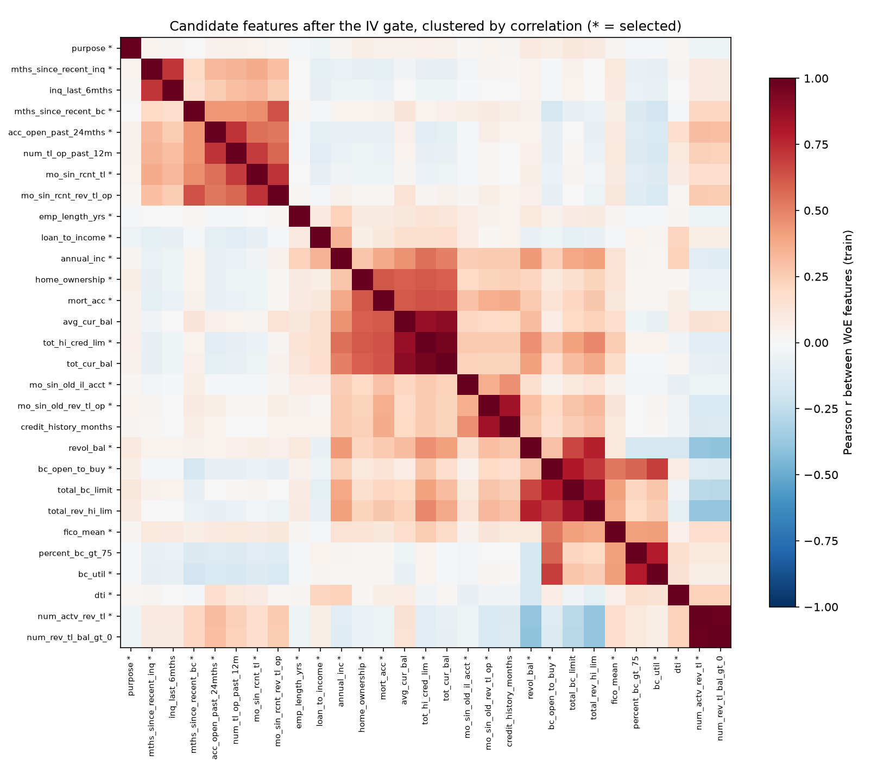
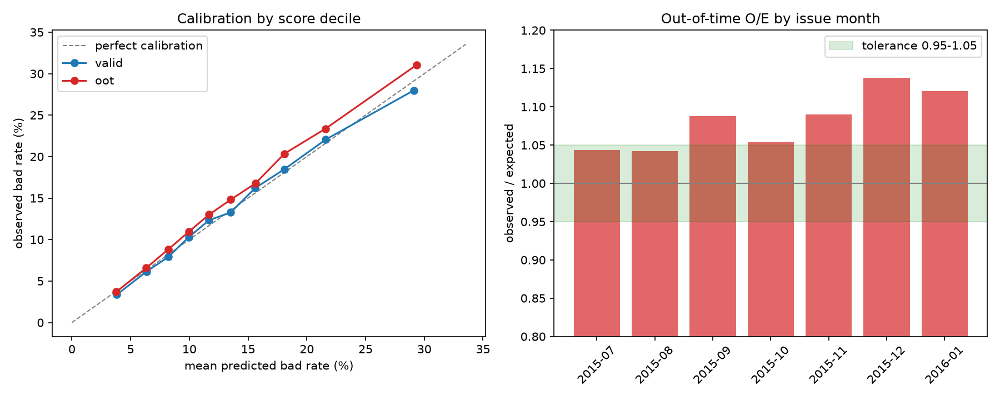
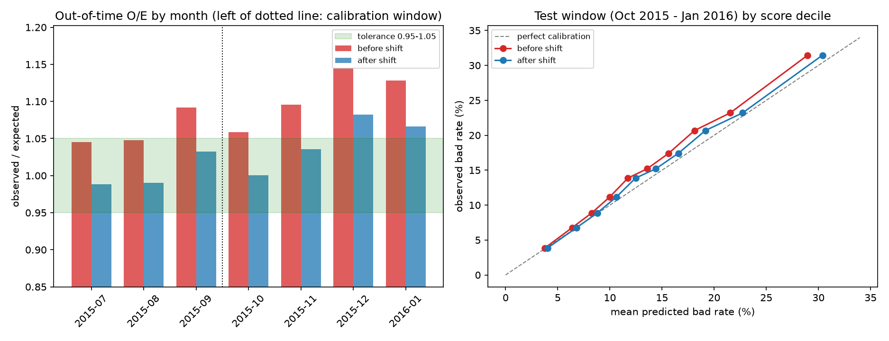
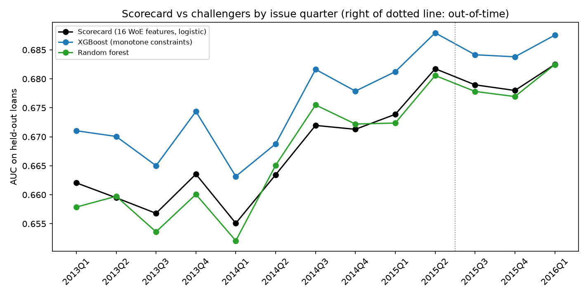
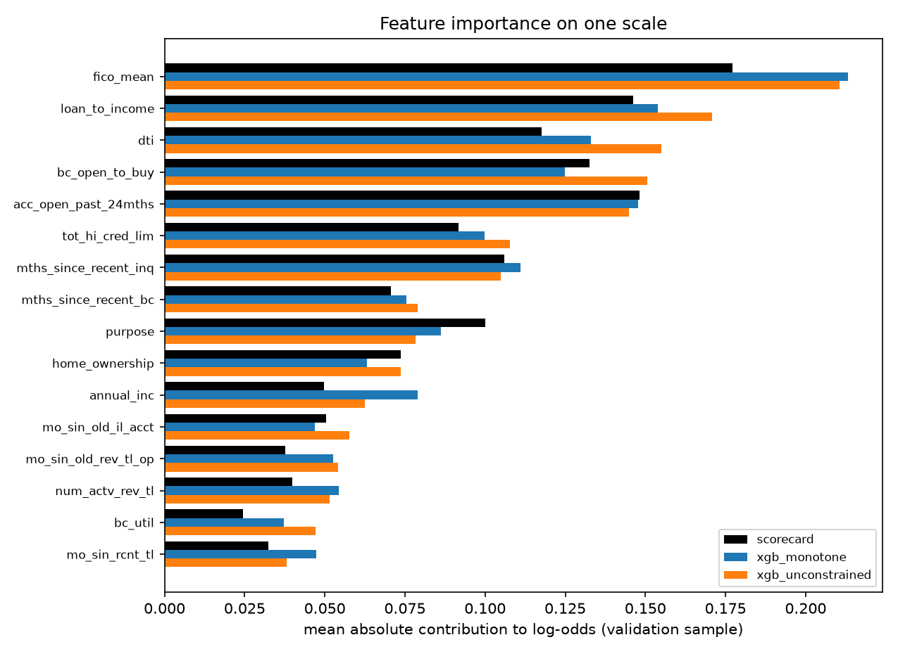
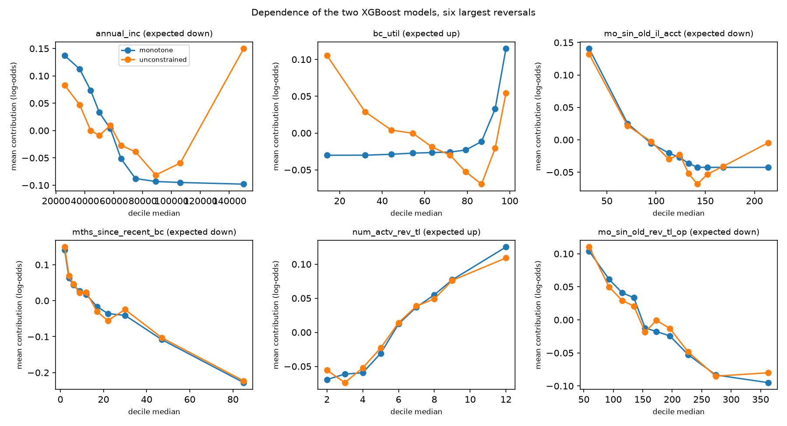
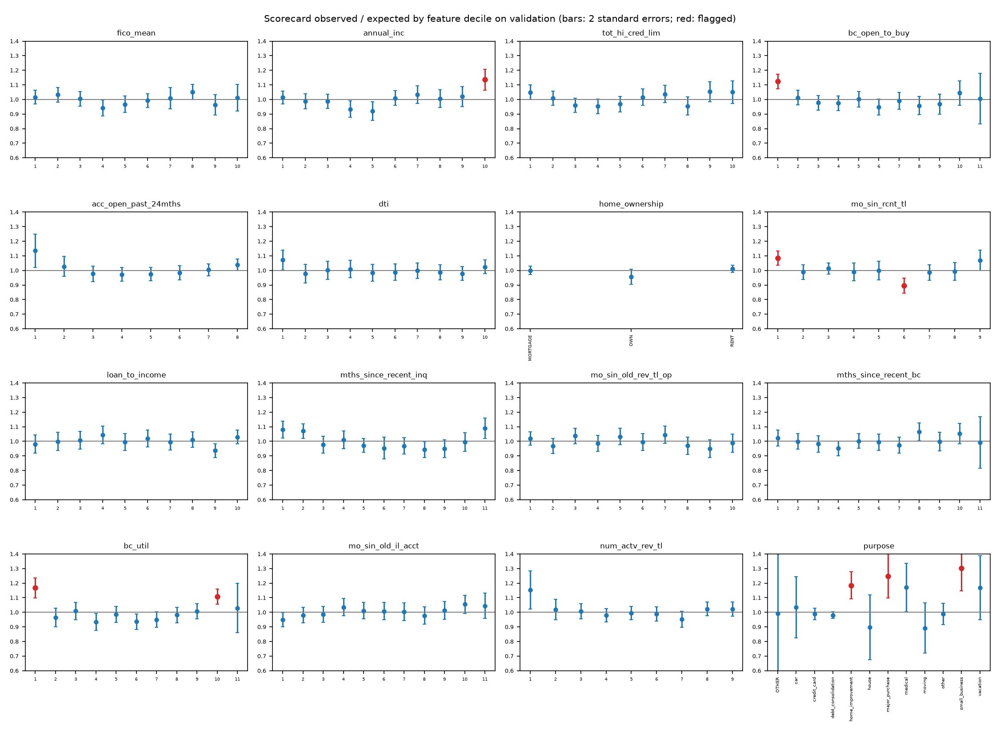
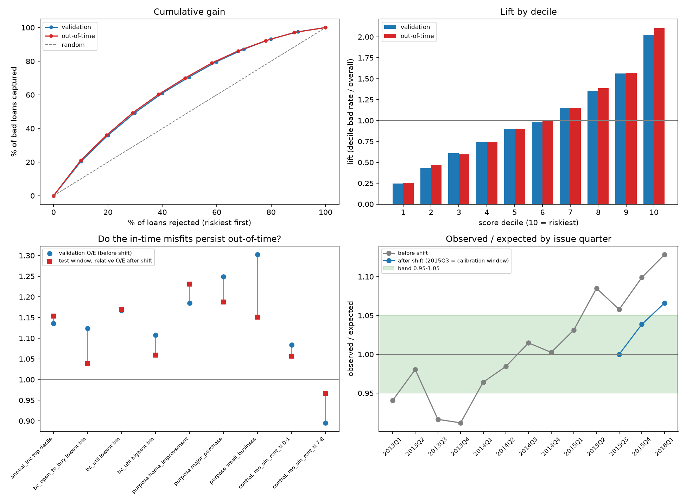

# PD Credit Risk Model — Methodology & Decision Log

This document tracks key modeling decisions as they are made, with the
reasoning behind each — the same way a model development document would
be written for independent validation review at a bank.

---

## Current rules at a glance

Quick reference to the rule in force for each topic and where it is documented.
Where a later section changes an earlier one, the earlier text is kept for the
audit trail and listed under "Replaces".

| Topic | Rule in force | Section | Replaces |
|---|---|---|---|
| Source data | Lending Club accepted loans 2007-2018 Q4, 2,260,701 rows x 151 columns, read in 200K-row chunks | 1 | |
| Target | Good = Fully Paid; Bad = Charged Off, Late (31-120 days), Default; Current, grace period, Late (16-30), policy-exception and blank statuses excluded | 3 | |
| Maturity filter | Loan kept only if issue date + term is on or before 2019-01-01 | 4, 5b | |
| Development population | 36-month loans issued Jan 2013 - Jan 2016: 568,694 loans, 14.10% bad | 7, 8 | The 696,232-loan maturity-filtered sample of Sections 4 and 5b (now an intermediate step) |
| Split | Train 307,025 and validation 76,757 (random, Jan 2013 - Jun 2015); out-of-time 184,912 (Jul 2015 - Jan 2016) | 9 | |
| Eligible columns | Origination-time columns only; 38 post-origination columns excluded; grade, sub_grade, int_rate kept as benchmark only | 6, 10 | |
| Missing values | Structural gaps get their own bin; revol_util, pct_tl_nvr_dlq and avg_cur_bal get a train median; no other imputation | 9, 11 | Section 2 planned treatment, Section 7 working hypothesis and Section 8 residual-gap plan (bankcard fields are structural, not median-imputed) |
| Rare categorical levels | Levels under 0.2% of train grouped to OTHER | 10 | The initial 1% rule noted in Section 10 |
| Binning | Entropy-tree bins (min size max(1,000 loans, 2% of non-missing)), monotone merge, WoE = ln(%good/%bad) | 11 | |
| Dropped after binning | initial_list_status, num_tl_120dpd_2m, addr_state | 11 | |
| Limitations and governance | Accepted-loans-only scope, label vs Basel definition, excluded loans, fair-lending screen, drift and recalibration plan | 12 | |
| Variable selection | IV at least 0.02 (emp_length_yrs forced in); WoE correlation below 0.70; VIF below 5; payment_to_income excluded (embeds int_rate): 19 features | 13 | |
| Development scorecard | Unregularised logistic regression on the 19 WoE features, fitted on train; validation and out-of-time scored only | 14 | |
| Final model | 16 features: emp_length_yrs dropped by decision, revol_bal and mort_acc dropped by the leave-one-out rule; logistic regression fitted on train | 15 | The 19-feature scorecard of Section 14 |
| Recalibration | Intercept shift of 0.0689 log-odds fitted on Jul-Sep 2015; test O/E 1.044 on Oct 2015 - Jan 2016 (pass, band 0.95-1.05); 0.1008 fitted on all out-of-time loans stored for deployment, untested | 15 | |
| Challenger models | XGBoost with monotone constraints is 0.0055 AUC ahead out-of-time (0.0078 on validation): small; random forest no better; unconstrained XGBoost 0.011 ahead out-of-time (diagnostic). The scorecard stays the primary model | 16 | |
| SHAP analysis | Same five features lead in all three models; annual_inc and bc_util show non-monotone dependence in the unconstrained model; interactions carry about 46% of its attributed effect (31% monotone); adding loan_amnt to the scorecard gains +0.0001 AUC (not supported) | 17 | |
| Segment calibration and capacity candidates | 9 of 156 feature bins flagged on validation (7 also in train): top income decile, bc_util extremes, lowest bc_open_to_buy, three purpose levels; no capacity candidate qualifies; the model is unchanged | 18 | |
| Validation suite (frozen model) | Rank ordering and policy metrics stable out-of-time (KS 0.256; rejecting 20% captures 36% of bad loans); calibration drifts with vintage (O/E 0.91 in 2013Q4 to 1.13 in 2016Q1, 1.066 after the shift in 2016Q1); 5 of 7 segment misfits persist | 19 | |

---

## 1. Dataset

**Source:** Lending Club accepted loans, 2007–2018 (Kaggle mirror:
`wordsforthewise/lending-club`, file `accepted_2007_to_2018Q4.csv.gz`)

**Why this dataset over a pre-cleaned alternative (e.g. "Give Me Some
Credit"):** The goal of this project is to demonstrate the full PD
model development lifecycle, including data preprocessing and missing
value treatment. Pre-cleaned competition datasets (10–12 columns, no
raw dates/categoricals) skip that work. Lending Club's raw data has
151 columns, mixed types, genuine structural and random missingness,
and requires the analyst to define the target variable from
`loan_status` rather than being handed a clean binary label — all of
which mirrors a real bank model development exercise more closely.

**Scale:** 2,260,701 rows × 151 columns raw.

**Technical note:** the full file could not be loaded into memory on
this machine in one `pd.read_csv()` call (`pandas.errors.ParserError:
... out of memory`). All exploratory passes are therefore done via
chunked reads (`chunksize=200_000`), accumulating aggregate statistics
(null counts, value counts, groupby sums) across chunks rather than
materializing the full dataframe. This will also inform the
preprocessing pipeline design — later stages need to either continue
chunking, downcast dtypes aggressively, or load a reduced column set.

---

## 2. Missingness structure

Full map saved at `reports/missingness_map.csv`. Key finding: **most
severe missingness is structural, not random.**

| Missingness band | Example columns | Interpretation |
|---|---|---|
| 94–100% | `member_id`, `hardship_*`, `settlement_*`, `sec_app_*`, `*_joint` | Only populated when a specific condition applies (hardship plan entered, debt settlement reached, joint application). Missing = "condition not applicable," which is itself informative — not a data quality defect. |
| 38–84% | `mths_since_last_record`, `il_util`, `open_il_*`, `all_util`, etc. | Lending Club began collecting these fields partway through its history. Missingness here is largely a **vintage/reporting-availability effect**, to be verified against `issue_d` before deciding on imputation. |
| 0–13% | `emp_title`, `emp_length`, `mths_since_recent_inq`, various `num_*`/`mo_sin_*` tradeline fields | Genuine borrower-level gaps. These will need real imputation treatment (and will be the main "missing value handling" showcase of this project). |
| ~0% | `loan_amnt`, `term`, `int_rate`, `grade`, `installment`, `annual_inc`, `dti`, FICO fields, `purpose` | Core origination fields, essentially complete. |

**Planned treatment (to be finalized in the feature engineering
stage):** structural-missing columns → either drop (if post-origination/
leakage risk) or convert to indicator flags; vintage-driven missing →
check availability by `issue_d` before imputing; borrower-level gaps →
standard imputation (median/mode or model-based) with missingness
indicator flags retained where missingness itself may be predictive.

---

## 3. Target variable definition

Raw `loan_status` distribution (full population, `n = 2,260,701`):

| Status | Count | % |
|---|---|---|
| Fully Paid | 1,076,751 | 47.63% |
| Current | 878,317 | 38.85% |
| Charged Off | 268,559 | 11.88% |
| Late (31-120 days) | 21,467 | 0.95% |
| In Grace Period | 8,436 | 0.37% |
| Late (16-30 days) | 4,349 | 0.19% |
| Does not meet credit policy: Fully Paid | 1,988 | 0.09% |
| Does not meet credit policy: Charged Off | 761 | 0.03% |
| Default | 40 | 0.00% |
| NaN | 33 | 0.00% |

**Mapping used:**
- **Good (target = 0):** `Fully Paid`
- **Bad (target = 1):** `Charged Off`, `Late (31-120 days)`, `Default`
- **Excluded:**
  - `Current` — censored outcome; the loan has not finished its term,
    so its eventual good/bad status is unknown. Labeling these as
    "good" would be incorrect by construction, not just noisy.
  - `In Grace Period`, `Late (16-30 days)` — early-stage delinquency
    that could still cure or progress; forcing a binary label here
    would be guessing an unresolved outcome.
  - `Does not meet the credit policy: *` — originated under a
    different/earlier underwriting policy than the rest of the
    dataset. Including these would mix two non-comparable
    populations into one model, violating the principle of modeling
    on a consistent population.
  - `NaN` — dropped (33 rows, negligible).

---

## 4. Sample window — vintage maturity filter (avoiding survivorship bias)

**Problem:** Simply excluding `Current` loans and using all remaining
resolved loans introduces **survivorship/selection bias**. Recent
vintages (e.g. 2017–2018) that appear "Fully Paid" are disproportionately
short-duration loans that happened to resolve quickly; most 2017–2018
originations — especially 60-month loans — are still `Current` and
would be excluded, skewing the resolved sample away from a
representative cross-section of recent originations.

**Fix:** Restrict the modeling population to loans whose **maturity
date** (`issue_d + term`) falls before the data's effective snapshot
date, so every included loan has had the full opportunity to reach a
final outcome.

- Snapshot date determined empirically from the data: max
  `last_pymnt_d` = 2019-03, max `last_credit_pull_d` = 2019-04. Used
  **2019-01-01** as the effective snapshot with a buffer for reporting
  lag.
- Resulting cutoffs: **36-month loans** must be issued on or before
  **Jan 2016**; **60-month loans** must be issued on or before **Jan
  2014**.

This is the standard approach for defining a PD model's development
sample window at a real institution — pick a window where outcomes
are fully observed, rather than an arbitrary recent cutoff.

---

## 5. Build log (audit table)

One row per script. Dates are commit dates (not necessarily the day a script was first
run) and commits are mapped to scripts by commit message (the newest row's hash is filled in by the next documentation commit). Scripts 01-06 were first
committed under Notebooks/; the folder was renamed to lowercase in commit 04e9fef.

| Date | Commit | Script | What it does | Main output |
|---|---|---|---|---|
| 2026-10-07 | 1faf713 | notebooks/01_raw_inspection.py | Raw shape and column list | 2,260,701 rows x 151 columns |
| 2026-10-07 | 1faf713 | notebooks/02_missingness_and_target.py | Chunked missingness map | reports/missingness_map.csv |
| 2026-10-07 | 1faf713 | notebooks/03_target_definition.py | loan_status counts | reports/loan_status_counts.csv |
| 2026-10-07 | 1faf713 | notebooks/04_vintage_check.py | Loans by issue year and term | reports/vintage_by_term.csv |
| 2026-10-07 | 1faf713 | notebooks/05_snapshot_date.py | Effective snapshot date | max last_pymnt_d 2019-03; max last_credit_pull_d 2019-04 |
| 2026-10-07 | 1faf713 | notebooks/06_build_target.py | Maturity filter and target mapping | data/processed/modeling_sample_ids_target.csv (696,232 loans, 14.82% bad) |
| 2026-10-08 | f97ba09 | notebooks/07_leakage_audit.py | Column classification | reports/column_classification.csv |
| 2026-10-08 | f97ba09 | notebooks/08_sample_missingness.py | Missingness inside the modeling sample | reports/sample_missingness.csv, reports/sample_missingness_by_year.csv (both committed in 229f343) |
| 2026-10-08 | 229f343 | notebooks/09_missingness_by_year_and_bad_rate.py | Missingness by year; bad rate by year and term | console output (Section 7) |
| 2026-10-08 | 04e9fef | notebooks/10_development_sample.py | Development sample and missingness diagnostics | data/processed/development_sample_ids_target.csv (568,694 loans, 14.10% bad); reports/dev_sample_*.csv |
| 2026-10-08 | d23d97c | notebooks/11_split_and_missing_flags.py | Train / validation / out-of-time split; missing-flag signal | data/processed/development_split.csv (not tracked); reports/missing_flag_signal.csv |
| 2026-10-08 | 7e9f94a | notebooks/12_feature_engineering.py | Feature table | data/processed/features.parquet (not tracked); reports/feature_dictionary.csv, categorical_levels.csv, winsor_thresholds.csv |
| 2026-10-10 | a33ebec | notebooks/13_woe_binning.py, src/woe.py | WoE/IV binning | models/woe_spec.json; reports/woe_bins.csv, reports/iv_summary.csv |
| 2026-10-10 | 7da2c8a | notebooks/14_governance_checks.py | Label composition; excluded-loan breakdown and bounds | console output (Section 12) |
| 2026-10-10 | 6fd2dee | notebooks/15_variable_selection.py | Variable selection (IV gate, correlation filter, VIF) | reports/variable_selection.csv, reports/woe_corr_train.csv, reports/figures/woe_correlation.png, models/selected_features.json |
| 2026-10-11 | 79a2fee | notebooks/16_scorecard.py | Logistic-regression scorecard, ablations, calibration | reports/scorecard_*.csv, reports/figures/scorecard_calibration.png, models/scorecard_params.json |
| 2026-10-11 | 054ba23 | notebooks/17_final_model_recalibration.py | Leave-one-out, final model, recalibration | reports/loo_validation.csv, final_model_coefficients.csv, final_model_metrics.csv, recalibration.csv, recalibration_monthly.csv, recalibration_deciles.csv, reports/figures/final_calibration.png, models/scorecard_final.json |
| 2026-10-11 | 829dc4b | notebooks/18_challenger_models.py | XGBoost and random forest challengers | reports/challenger_tuning.csv, challenger_metrics.csv, challenger_deltas.csv, challenger_by_quarter.csv, challenger_xgb_importance.csv, reports/figures/challenger_by_quarter.png, models/challenger_params.json |
| 2026-10-11 | 8a22e67 | notebooks/19_shap_analysis.py | TreeSHAP importance, dependence, interactions; loan-size test (validation only) | reports/shap_importance.csv, shap_monotonicity.csv, shap_interactions.csv, loan_size_test.csv, reports/figures/shap_importance.png, shap_profiles.png |
| 2026-10-12 | 1cd0bcd | notebooks/20_calibration_and_candidates.py | Calibration by feature decile; capacity-ratio candidates (validation only) | reports/calibration_by_feature.csv, reports/capacity_candidates.csv, reports/figures/calibration_by_feature.png |
| 2026-10-12 | (Section 19 commit) | notebooks/21_validation_suite.py | Lift and gain, confusion matrix, segment back-tests, stability by quarter (frozen model) | reports/validation_deciles.csv, validation_confusion.csv, validation_segments.csv, validation_by_quarter.csv, reports/figures/validation_suite.png |

---

## 5b. Target construction run results (supplements Sections 3 and 4)

Running `notebooks/06_build_target.py`:

- Rows excluded as immature vintage: **1,561,567**
- Rows excluded as ambiguous/censored status (among mature loans): **2,902**
- **Final modeling sample: 696,232 loans**
- **Bad rate: 14.82%** (103,165 bad / 696,232 total)

Note: this bad rate is meaningfully lower than the ~21.6% naive estimate
from excluding only `Current` without a maturity filter. This is
consistent with the survivorship bias hypothesis in Section 4 — the
naive resolved-loan sample over-represented loans that failed quickly,
inflating the apparent bad rate. The maturity-filtered sample is
considered the more reliable, representative estimate of true
portfolio-level default risk.

---

## 6. Leakage audit and feature eligibility

A PD model may only use information available at loan origination.
All 151 raw columns were classified (`notebooks/07_leakage_audit.py`,
output in `reports/column_classification.csv`):

| Category | Columns | Treatment |
|---|---|---|
| Origination candidates | 100 | Eligible, subject to in-sample availability check |
| Post-origination leakage | 38 | Excluded (payment history, balances, recoveries, hardship and settlement fields, last-pull dates) |
| ID / target | 5 | Excluded |
| High-cardinality text | 4 | `emp_title`, `title`, `desc`, `zip_code`: special handling or exclusion |
| Lender-assigned | 3 | `grade`, `sub_grade`, `int_rate`: Lending Club's own risk output, so kept out of the primary model and reserved as a benchmark |
| Time reference | 1 | `issue_d`: used for time-based splitting, not as a predictor |

Notable: `last_fico_range_high/low` look like ordinary FICO scores but
are pulled after origination, so they are excluded; only
`fico_range_low/high` at application are valid.

Open question: several candidate fields were only collected for later
vintages, so full-file missingness can overstate availability in the
maturity-filtered sample. Availability is therefore re-measured within
the modeling sample before any treatment decisions are made.

---

## 7. Missingness inside the modeling sample, and development scope

Missingness was re-measured inside the 696,232-loan modeling sample
(`notebooks/08_sample_missingness.py`, `notebooks/09_missingness_by_year_and_bad_rate.py`).

**Finding 1: availability is era-driven, not random.**
About 30 bureau-attribute columns (`tot_cur_bal`, `num_sats`,
`avg_cur_bal`, `mort_acc`, `total_rev_hi_lim`, ...) are 100% missing for
2007-2011, ~52% missing in 2012, and ~0% from 2013 onward. Averaging
over the full sample hid this (it showed as 3-10% missing). Imputing
these would fabricate values for pre-2013 loans, so the sample window
is cut instead.

**Finding 2: later-collected fields.**
Roughly 30 further columns (`sec_app_*`, `*_joint`, `open_acc_6m`,
`il_util`, `all_util`, `inq_last_12m`, ...) are >=94% missing in the
sample because they were only populated for late-2015+ loans (or joint
applications). They are dropped. Limitation: they exist only for loans
too recent to have outcomes, so the model reflects what is learnable
from mature vintages.

**Finding 3: 60-month loans.**
60-month loans default at 21-28% vs 10-15% for 36-month loans, and
appear only through 2013 because later ones have not matured. They
could never appear in an out-of-time test.

**Decision: development sample = 36-month loans issued from Jan 2013.**
568,694 loans (from the 696,232-loan modeling sample: 93,153 pre-2013
loans and 34,385 60-month 2013 loans removed). Exact bad rate and
monthly counts are recorded in Section 8 after
`notebooks/10_development_sample.py`. `term` is no longer a feature.
Scoping a PD model to a single product is standard practice.

**Population drift (noted for the PSI/validation sections):** the
36-month bad rate rises from 12.3% (2013) to 13.7% (2014) to 14.9%
(2015).

**Remaining gaps after 2013** (`mths_since_recent_inq` ~11%,
`mo_sin_old_il_acct` ~3.6%, `bc_util` family ~1%, `emp_length` 4-7%,
`num_tl_120dpd_2m` 4-6%, and the `mths_since_*` delinquency fields at
51-85%): the working hypothesis is that missing means "does not apply"
(e.g. no installment accounts, no bankcards, no delinquency ever). This
is tested in script 10 before any treatment is chosen. Imputation
statistics will be fitted on training data only.

---

## 8. Development sample and missingness diagnostics

Script: notebooks/10_development_sample.py. Outputs:
reports/dev_sample_by_month.csv, reports/dev_sample_missingness.csv.

**Development sample:** 36-month loans issued Jan 2013 - Jan 2016.
568,694 loans (row-match check against the raw file passed), 80,202
bad, **14.10% bad rate**. By issue year: 2013 100,422 loans (12.33%);
2014 162,570 (13.73%); 2015 283,087 (14.90%); Jan 2016 22,615 (14.66%).

**Candidate availability (100 candidates):** 30 are >=90% missing
(dropped), 6 are 10-90% (`mths_since_*` fields), 5 are 1-10%, 59 are
<1%.

**Near-constant / constant (dropped):** `application_type` (99.92%
Individual), `disbursement_method` (99.97% Cash), `term` (all 36
months). `initial_list_status` is balanced (f 49.3% / w 50.7%) and is
retained for now.

**Does "missing" mean "does not apply"?** Missing rate by value of a
related condition column:

| Column | Condition column | Missing if 0 | Missing if >0 | Reading |
|---|---|---|---|---|
| mths_since_last_record | pub_rec | 100.0% | 0.0% | Structural: no public record |
| mo_sin_old_il_acct | num_il_tl | 99.6% | 0.0% | Structural: no installment accounts |
| mths_since_recent_inq | inq_last_6mths | 18.6% | 0.0% | Consistent with no recent inquiry; not fully verifiable (inq_last_12m dropped) |
| mths_since_last_delinq | delinq_2yrs | 61.8% | 1.5% | Mostly structural; ~1.7K inconsistent loans |
| mths_since_last_major_derog | num_accts_ever_120_pd | 93.0% | 3.6% | Mostly structural; ~4.9K inconsistent loans |
| mths_since_recent_bc | num_bc_tl | 99.5% | 0.7% | Structural for ~1,055 loans; ~4K residual gaps |
| bc_util / percent_bc_gt_75 / bc_open_to_buy | num_bc_tl | 91.6% / 100% / 91.6% | 0.9% / 0.9% / 0.8% | Mostly not structural: only ~1,060 loans lack bankcards, about one-sixth of the gaps |

`emp_length` is missing for 91.1% of loans with a blank `emp_title`
and 0.0% of loans with a title; about 99% of its gaps coincide with
no employer information being supplied.

Not tested: `mths_since_recent_bc_dlq`, `mths_since_recent_revol_delinq`
(no clean condition column); treated analogously, to be checked at the
binning stage.

**Planned treatment:** structural gaps (`mths_since_*`,
`mo_sin_old_il_acct`) get a missing indicator and a dedicated bin, no
imputation; `emp_length` gets a "no employment info" indicator and
Unknown category; residual gaps (`bc_*` family, `num_tl_120dpd_2m`)
get median imputation fitted on training data only plus a missing
flag. Whether each flag carries signal is tested by comparing bad
rates of missing vs present groups before the plan is finalised.

---

## 9. Train / validation / out-of-time split and missing-flag signal

Script: notebooks/11_split_and_missing_flags.py (seed 42). Outputs:
reports/missing_flag_signal.csv; data/processed/development_split.csv
(not tracked, regenerated by the script).

| Split | Window | Loans | Bad | Bad rate |
|---|---|---|---|---|
| Train | Jan 2013 - Jun 2015, 80% stratified random | 307,025 | 42,370 | 13.80% |
| In-time validation | same window, 20% | 76,757 | 10,592 | 13.80% |
| Out-of-time | Jul 2015 - Jan 2016 | 184,912 | 27,240 | 14.73% |

The out-of-time bad rate is 0.93pp above development: calibration may
drift even if rank-ordering holds. Feature decisions use train rows
only; the out-of-time set stays untouched until final assessment.

**Does the missing group behave differently?** Bad rate, missing vs
present, train rows only; same-year diff compares within issue year to
remove drift (missing minus present, percentage points):

| Column | % missing | Bad % missing / present | Same-year diff |
|---|---|---|---|
| mths_since_last_record | 82.8 | 13.44 / 15.52 | -1.76 |
| mths_since_last_major_derog | 72.8 | 13.34 / 15.03 | -1.47 |
| mths_since_recent_bc_dlq | 74.3 | 13.57 / 14.45 | -0.76 |
| mths_since_last_delinq | 50.5 | 13.48 / 14.12 | -0.48 |
| mths_since_recent_revol_delinq | 65.0 | 13.59 / 14.19 | -0.45 |
| mths_since_recent_inq | 10.3 | 9.84 / 14.26 | -4.40 |
| mo_sin_old_il_acct | 3.8 | 16.48 / 13.69 | +2.85 |
| mths_since_recent_bc | 0.9 | 16.02 / 13.78 | +2.14 |
| bc_util | 1.1 | 16.27 / 13.77 | +2.42 |
| percent_bc_gt_75 | 1.0 | 16.05 / 13.78 | +2.19 |
| bc_open_to_buy | 1.0 | 16.19 / 13.78 | +2.35 |
| num_tl_120dpd_2m | 2.9 | 17.01 / 13.71 | +2.89 |
| emp_length | 5.8 | 20.28 / 13.40 | +6.79 |
| emp_title | 6.6 | 19.71 / 13.38 | +6.38 |

**Bankcard gaps are structural (supersedes the Section 8 reading).**
Conditioning on num_bc_tl explained only ~1,060 loans; conditioning on
num_bc_sats (satisfactory bankcard accounts) explains almost all:
96.5-98.7% of the 5,331 loans with num_bc_sats == 0 are missing each of
bc_util, percent_bc_gt_75, bc_open_to_buy, mths_since_recent_bc, vs
0.0-0.1% when num_bc_sats > 0. num_actv_bc_tl == 0 does not explain
them (49-56%). The gaps cluster: of 567,634 loans with a bankcard,
562,379 miss none of the four, 4,144 miss all four, 450 miss three,
661 miss one.

**Revised treatment (supersedes the residual-gap plan in Section 8):**
structural gaps (the five mths_since_* delinquency fields,
mths_since_recent_inq, mo_sin_old_il_acct, the four bankcard fields)
get their own bin at the WoE stage, no imputation; emp_length gets an
Unknown bin (its gaps are ~99% a subset of emp_title gaps, so no second
flag); median imputation fitted on train only is reserved for the
sub-1% columns. A flag for mths_since_last_record would duplicate
pub_rec == 0 and is not added. num_tl_120dpd_2m is deferred to the
binning stage: it is 0.0% missing through 2013Q3, 0.7% in 2013Q4, then
3-6.5% from 2014Q1, consistent with a data-feed change.

**Drift note:** the emp_length missing share rose from 3.7% (2013Q1)
to 7.3% (2015Q4) with a ~6.8pp higher bad rate. Rough arithmetic
(about 0.25pp) explains only about a tenth of the 2.6pp rise in bad
rate between 2013 and 2015; most of the drift lies elsewhere.
Associations are descriptive, not causal.

---

## 10. Feature engineering

Script: notebooks/12_feature_engineering.py. Outputs:
data/processed/features.parquet (not tracked), reports/feature_dictionary.csv,
reports/categorical_levels.csv, reports/winsor_thresholds.csv.

**Principle:** every data-dependent step (rare-level grouping,
winsorisation caps) is fitted on train rows only and applied unchanged to
validation and out-of-time. No imputation at this stage: NaNs stay for the
binning step.

**Kept / dropped.** Of 100 origination candidates: 30 sparse columns
(>=90% missing) dropped; term, application_type, disbursement_method
dropped as (near-)constant; funded_amnt (equal to loan_amnt for 100.0% of
loans) and funded_amnt_inv (investor-funded share, equal for 92.9%) dropped
as copies of loan_amnt or funding outcomes. zip_code, emp_title, title and
desc are excluded (high-cardinality text; zip code is also a fair-lending
concern). grade, sub_grade and int_rate are stored as bench_* columns only:
they are Lending Club's own risk output and are not predictors in the
primary model. Result: 66 features (61 numeric, 5 categorical).

**Derived features.** fico_mean (midpoint of the application FICO range;
width is 4 for 568,630 loans and 5 for 64); credit_history_months
(earliest_cr_line to issue date; no unparseable or negative values);
emp_length_yrs ('< 1 year' = 0, '10+ years' = 10; 35,181 NaNs, 6.2%, kept
for an Unknown bin); loan_to_income and payment_to_income.

**Data checks.** dti has no negative values; 7 loans exceed 100 although
the train maximum is 39.99 (outside the train range, handled by the
train-fitted cap).

**Winsorisation.** 16 amount/ratio columns capped at the train 0.1th and
99.9th percentiles (thresholds in reports/winsor_thresholds.csv). About
0.1-0.2% of train rows are clipped per column. Several columns clip more
out-of-time (dti 0.35% vs 0.20%, payment_to_income 0.42% vs 0.20%,
annual_inc 0.29% vs 0.20%, total_rev_hi_lim 0.28% vs 0.19%): mild tail
drift, to be quantified by PSI.

**Categoricals.** home_ownership, verification_status, purpose, addr_state,
initial_list_status. Levels below 0.2% of train are grouped to OTHER. The
rule is deliberately risk-blind: an initial 1% threshold pooled purposes
and states with different default rates, so it was lowered and risk-based
grouping is left to the WoE stage.

**Leakage tripwire.** Single-feature AUC on train: maximum 0.597
(fico_mean), none above 0.70; benchmark int_rate 0.654. This catches gross
leakage only; the primary control is the column-level audit in Section 6.

**Still to treat:** structural NaNs get their own bin; revol_util (0.04%)
and pct_tl_nvr_dlq (0.03%) get a train-fitted median. The credit-scale
columns (tot_hi_cred_lim, total_bc_limit, avg_cur_bal, tot_cur_bal,
total_rev_hi_lim, bc_open_to_buy, annual_inc) are expected to be
collinear; variable selection will cluster them.

Categorical result at the 0.2% threshold: purpose 14 -> 12 levels (OTHER =
0.15% of loans: wedding, renewable_energy, educational); addr_state 51 -> 47
levels (OTHER = 0.29%). small_business, car and medical (0.93-0.99% of train
each) are kept as separate levels; the initial 1% rule would have pooled them.

---

## 11. WoE / IV binning

Script: notebooks/13_woe_binning.py; module: src/woe.py (WoEBinner). Outputs:
models/woe_spec.json (cut points and WoE per bin), reports/woe_bins.csv (per-bin counts
and bad rates for train, validation and out-of-time), reports/iv_summary.csv (IV,
stability and review flags per feature).

**Method (everything fitted on train rows only).**
- Numeric: an entropy decision tree proposes up to 10 cut points; every bin holds at
  least max(1,000 loans, 2% of the non-missing rows). Adjacent bins are then merged
  (pool adjacent violators) until the bad rate is monotone in the feature; the direction
  is whichever gives the higher IV.
- Missing values: structural-missing features get a dedicated Missing bin. revol_util,
  pct_tl_nvr_dlq and avg_cur_bal get a train median instead (avg_cur_bal was added after
  the first run: its Missing bin held a handful of loans and only 2 bad).
- Categorical: levels are ordered by train bad rate and grouped by the same tree, so
  groups are contiguous in risk. Levels unseen in train receive a neutral WoE of 0.
- Convention: WoE = ln(%good / %bad), so a higher WoE is a safer bin; IV is the sum of
  (%good - %bad) x WoE. Counts are floored at 0.5 so an empty bin cannot give log(0).
  Applying the saved spec to train reproduces the fit-time IV exactly (checked for every
  feature).
- Validation and out-of-time are used only for testing: IV with the train WoE on each
  split, PSI of bin shares against train, and whether the bin order holds.

**Results (66 features).** IV bands on train (common rule of thumb): strong 0, medium 1,
weak 28, useless 37, suspicious 0.

| Feature | IV train | IV validation | IV out-of-time |
|---|---|---|---|
| fico_mean | 0.139 | 0.139 | 0.157 |
| annual_inc | 0.081 | 0.074 | 0.069 |
| tot_hi_cred_lim | 0.080 | 0.077 | 0.077 |
| bc_open_to_buy | 0.079 | 0.084 | 0.084 |
| avg_cur_bal | 0.076 | 0.074 | 0.072 |
| total_bc_limit | 0.073 | 0.076 | 0.080 |
| acc_open_past_24mths | 0.071 | 0.073 | 0.093 |
| tot_cur_bal | 0.066 | 0.062 | 0.061 |
| payment_to_income | 0.064 | 0.062 | 0.060 |
| total_rev_hi_lim | 0.060 | 0.058 | 0.067 |

- Stability: for all of the top 25, out-of-time IV is 0.85-1.34 times train IV; the
  recent-activity features (acc_open_past_24mths, num_tl_op_past_12m, inq_last_6mths,
  mths_since_recent_inq) gain about 30% IV out-of-time. The monotone constraint costs at
  most 5.1% of IV among the top 25. PSI(out-of-time) is below 0.10 for every feature
  except initial_list_status (0.277); the largest in the top 25 is 0.027.
- Review flags: the first run flagged 6 features for an out-of-time bin-order reversal
  (annual_inc, mo_sin_old_rev_tl_op, percent_bc_gt_75, mo_sin_old_il_acct,
  credit_history_months, num_actv_rev_tl) because any reversal counted as broken. With
  reversals now counted only beyond 2 standard errors of the difference, one remains:
  percent_bc_gt_75 (IV 0.032 train, 0.031 out-of-time, PSI 0.027); it is resolved at variable selection. In the out-of-time set its 75.75-82.1 bin (3,632 loans) shows 19.52% bad against 17.09% for the top bin, a reversal of about 3.5 standard errors; in train the two top bins are indistinguishable (16.36% vs 16.40%), so if the feature is kept they are merged, at negligible IV cost.
- Missing bins behave as hypothesised: mths_since_recent_inq Missing (no recent inquiry)
  9.84% bad vs 17.05% for an inquiry within 1.5 months, continuing the ordering of the
  non-missing bins; emp_length_yrs Missing (no employer information) 20.28% bad, WoE
  -0.46, on 17,707 train loans; num_tl_120dpd_2m Missing 17.01% bad but IV 0.002;
  mths_since_last_record IV 0.005.
- Calibration drift is visible in the bins: the out-of-time bad rate is higher than train
  in every fico_mean bin (about +1.8pp in the two riskiest, +0.1pp in the safest) while
  bin shares barely move (PSI 0.005). Rank ordering holds; the level of default rates
  rose.
- purpose: raw train bad rates run from 11.5% (car) to 22.9% (small_business, 2,987
  loans), with moving 20.4% and house 16.9%. The 2% minimum bin size merges house,
  moving and small_business into one bin of 6,160 loans at 20.94%, which understates
  small_business by 1.9pp and overstates house by 4.0pp (2.0% of train loans). Accepted:
  purpose IV is 0.021 and the group still carries the risk ordering.
- addr_state: 47 levels grouped into 10 risk-ordered bins (9.85% to 17.21% bad), IV 0.016.

**Decisions.**
- Excluded from variable selection: initial_list_status (PSI 0.277 out-of-time vs 0.0 for
  the random validation split, so the shift is time-driven; IV 0.006; it describes how the
  loan was listed, not the borrower), num_tl_120dpd_2m (IV 0.002; missingness tied to a
  2014 data-feed change) and addr_state (IV 0.016 is below the 0.02 line and geography is a
  possible proxy for protected characteristics; see Section 12).
- Features under IV 0.02 are candidates to drop at selection. 0.02 is a soft line:
  emp_length_yrs (0.0197) and purpose (0.0208) go forward because their effect sits in
  small, interpretable groups.
- Next: correlation clustering on the WoE features (the credit-size family tot_hi_cred_lim,
  total_bc_limit, avg_cur_bal, tot_cur_bal, total_rev_hi_lim, bc_open_to_buy, annual_inc is
  expected to collapse), then the first logistic-regression scorecard.

---

## 12. Limitations and governance

Script: notebooks/14_governance_checks.py (console output only). This section records what
the development sample can and cannot support, and the rules for monitoring it.

### 12.1 Population: accepted loans only (no reject inference)

The data contain only loans that Lending Club accepted and funded; rejected applicants have
no repayment outcome. The model therefore describes the accepted population, and its PDs are
valid only for applicants who would have been accepted under the 2013-2015 policy. Applying
it to the full applicant pool would extrapolate beyond the data. Reject inference was not
performed: the rejected-applications file carries only a handful of application fields, so
an extension would be weak and is out of scope. The sample is further limited to 36-month
loans issued Jan 2013 - Jan 2016 (Sections 7 and 8).

### 12.2 Default definition and horizon

Composition of the bad label in the development sample (568,694 loans, 80,202 bad):

| Status | Loans | % of bad | % of all loans |
|---|---|---|---|
| Charged Off | 80,058 | 99.82 | 14.08 |
| Late (31-120 days) | 144 | 0.18 | 0.03 |
| Default | 0 | 0 | 0 |

The label is in effect "charged off". Late (31-120) loans appear only at the end of the
window (0.00% of loans issued in 2013-2014, 0.02% in 2015, 0.37% in Jan 2016, where some
loans were still delinquent at the snapshot), so the part of the label below 90 days past
due is immaterial here.

Gaps to the Basel definition (default = 90+ days past due, or unlikely to pay):
- A charge-off occurs after a longer delinquency than 90 days (the exact timing should be
  verified against Lending Club's servicing policy before a figure is quoted). Loans that
  reached 90+ days past due and later cured are labelled good. Against a 90+ days-past-due
  definition the observed bad rate is therefore probably understated; rank-ordering is
  likely affected less than the level of PD.
- This cannot be re-labelled: the file has no monthly payment history.
- Horizon: the target is default at any point in the full 36-month life (a cumulative PD),
  not the 12-month PD used for Basel or IFRS 9 stage 1. Converting would need default-timing
  data that this snapshot does not contain.
- The 2013-2016 vintages were observed in a benign credit environment: the PDs are
  point-in-time for that window, and are neither through-the-cycle nor downturn estimates.

### 12.3 Loans excluded for an ambiguous status

2,902 mature loans were excluded in Section 5b:

| Status | Loans | Inside development window |
|---|---|---|
| Does not meet the credit policy: Fully Paid | 1,988 | 0 |
| Does not meet the credit policy: Charged Off | 761 | 0 |
| Current | 126 | 120 |
| In Grace Period | 17 | 16 |
| Late (16-30 days) | 10 | 10 |
| Total | 2,902 | 146 |

The 2,749 policy-exception loans (94.7%) were all issued in 2007-2010, outside the 2013+
development window. Only 146 loans (0.03% of the development sample) are ambiguous-status
loans inside it. Their outcome cannot be followed (the file is a snapshot), but the effect is
bounded: the development bad rate of 14.10% would be 14.10% if all 146 were good and 14.12%
if all were bad. On the earlier 696,232-loan sample the bounds were 14.76% to 15.17% (base
14.82%). Excluding them is immaterial.

### 12.4 Fair lending

- Excluded: zip_code (fine geography, Section 10) and addr_state (Section 11: IV 0.016 is
  below the 0.02 line, and state is a possible geographic proxy for protected
  characteristics).
- Retained for testing: emp_length_yrs (IV 0.0197). Employment length can correlate with age
  and employment status (for example, retirees report no current employer), and its Missing
  bin (no employer information, 17,707 train loans, 20.28% bad) is the largest
  missing-group effect in Section 9 (+6.8pp within the same issue year). That link is a
  hypothesis: the data has no age field to test it.
- Plan: when the scorecard is built, report AUC and KS with and without emp_length_yrs; if
  the loss is negligible, drop it.
- Limitation: the dataset has no protected-class attributes (race, sex, age), so a
  disparate-impact test cannot be run; in practice it would use collected or proxy-inferred
  attributes. Other credit-capacity variables (income, credit limits) can also act as
  proxies; this is documented, not tested.

### 12.5 Drift response

Observed: the out-of-time bad rate is 14.73% against 13.80% in train and validation (+0.93pp,
+6.7% relative, about 9 standard errors, so not sampling noise). Feature PSI is below 0.10
for every feature except initial_list_status (excluded), so this is mainly calibration drift,
not a change in applicant mix: in every fico_mean bin the out-of-time bad rate is higher than
in train (about +1.8pp in the two riskiest bins, +0.1pp in the safest) while bin shares
barely move.

Response plan:
1. Assess discrimination (AUC, KS, Gini) and calibration (observed/expected overall and by
   score decile, calibration intercept and slope) separately, on validation and out-of-time.
2. Tolerance (initial, to be justified): overall observed/expected within 0.95-1.05. The
   standard error of observed/expected on the out-of-time set is about 0.6% relative, so
   +-5% is well outside sampling noise. It was set knowing the 0.93pp base-rate gap, before
   the final scorecard's observed/expected has been seen.
3. If outside the band: recalibrate with an intercept-only shift in log-odds (slope kept
   unless the calibration slope departs materially from 1). To keep a clean test, fit the
   shift on Jul-Sep 2015 (73,569 loans) and test on Oct 2015 - Jan 2016 (111,343 loans);
   report both.
4. Monitoring after deployment: feature and score PSI (0.10 = watch, 0.25 = act; common
   conventions), observed/expected and Gini by quarter. Gini-drop and re-development
   triggers are set once the scorecard's out-of-time Gini is known.

### 12.6 Other limitations

- One lender, one product (36-month loans), one country and a three-year origination window;
  no downturn period.
- About 30 bureau fields were only populated for recent loans and cannot be used (Section 7).
- The purpose grouping merges house, moving and small_business into one bin (Section 11).

---

## 13. Variable selection

Script: notebooks/15_variable_selection.py. Outputs: reports/variable_selection.csv (status and
reason for all 66 features), reports/woe_corr_train.csv, reports/figures/woe_correlation.png,
models/selected_features.json. All statistics use train rows only.

**Rules (fixed before the results were seen).**
1. Exclusions already decided: initial_list_status, num_tl_120dpd_2m, addr_state (Sections 11
   and 12.4).
2. IV gate: train IV of at least 0.02; emp_length_yrs (0.0197) is forced in (Section 11).
3. Correlation filter on the WoE-transformed features: walking down by IV (features without a
   review flag before flagged ones), a feature is dropped if its absolute correlation with an
   already-kept feature is 0.70 or more. The cut-off is a convention (0.60-0.80 is common);
   sensitivity is noted below.
4. VIF of the survivors below 5 (common rule of thumb).

**A fourth exclusion, found after the first run: payment_to_income.** The first run kept
payment_to_income and dropped loan_to_income (correlation 0.97 between their WoE values).
payment_to_income is built from installment, and for a fixed 36-month term installment divided
by loan_amnt is a monotone function of the interest rate (train correlation 0.9989 with
int_rate). The feature therefore carries Lending Club's risk-based price, which Section 10
keeps out of the primary model (grade, sub_grade and int_rate are benchmark-only). The two
ratios differ only by that rate term (up to the winsorisation caps), which is why
payment_to_income has the higher IV (0.0638 vs 0.0408) and single-feature AUC (0.5686 vs
0.5547) despite the 0.97 correlation. It would also be circular if the PD were ever used to
set price. It is excluded and loan_to_income is used; the cost is measured in an ablation at
the scorecard stage.

**Funnel.** 66 features; 4 excluded (earlier decisions and the exclusion above); 33 dropped
for IV below 0.02; 29 candidates (including emp_length_yrs); 10 dropped for correlation;
**19 kept**; maximum VIF 3.39.

Dropped for correlation:

| Feature | IV train | Dropped because |
|---|---|---|
| avg_cur_bal | 0.0757 | r = 0.87 with tot_hi_cred_lim |
| total_bc_limit | 0.0726 | r = 0.80 with bc_open_to_buy |
| tot_cur_bal | 0.0658 | r = 0.96 with tot_hi_cred_lim |
| total_rev_hi_lim | 0.0596 | r = 0.71 with bc_open_to_buy |
| num_tl_op_past_12m | 0.0594 | r = 0.72 with acc_open_past_24mths |
| mo_sin_rcnt_rev_tl_op | 0.0374 | r = 0.72 with mo_sin_rcnt_tl |
| percent_bc_gt_75 | 0.0319 | r = 0.79 with bc_util |
| inq_last_6mths | 0.0317 | r = 0.72 with mths_since_recent_inq |
| credit_history_months | 0.0217 | r = 0.84 with mo_sin_old_rev_tl_op |
| num_rev_tl_bal_gt_0 | 0.0214 | r = 0.99 with num_actv_rev_tl |

Selected features:

| Feature | Type | IV train | Max abs. correlation with a kept feature | VIF |
|---|---|---|---|---|
| fico_mean | numeric | 0.1392 | 0.52 | 1.63 |
| annual_inc | numeric | 0.0807 | 0.55 | 2.11 |
| tot_hi_cred_lim | numeric | 0.0795 | 0.64 | 2.87 |
| bc_open_to_buy | numeric | 0.0786 | 0.69 | 3.39 |
| acc_open_past_24mths | numeric | 0.0706 | 0.55 | 1.79 |
| dti | numeric | 0.0578 | 0.23 | 1.36 |
| mort_acc | numeric | 0.0484 | 0.64 | 2.19 |
| home_ownership | categorical | 0.0437 | 0.62 | 1.92 |
| mo_sin_rcnt_tl | numeric | 0.0419 | 0.55 | 1.68 |
| loan_to_income | numeric | 0.0408 | 0.34 | 1.26 |
| mths_since_recent_inq | numeric | 0.0366 | 0.37 | 1.22 |
| mo_sin_old_rev_tl_op | numeric | 0.0357 | 0.36 | 1.39 |
| mths_since_recent_bc | numeric | 0.0350 | 0.46 | 1.47 |
| bc_util | numeric | 0.0276 | 0.69 | 2.79 |
| mo_sin_old_il_acct | numeric | 0.0219 | 0.36 | 1.24 |
| num_actv_rev_tl | numeric | 0.0217 | 0.39 | 1.52 |
| revol_bal | numeric | 0.0211 | 0.45 | 2.23 |
| purpose | categorical | 0.0208 | 0.09 | 1.02 |
| emp_length_yrs | numeric | 0.0197 | 0.23 | 1.06 |

**Observations.**
- The credit-size family (avg_cur_bal, tot_cur_bal, total_bc_limit, total_rev_hi_lim) collapsed
  into tot_hi_cred_lim and bc_open_to_buy; annual_inc survives (correlation 0.55 with
  tot_hi_cred_lim). The one feature that carried a review flag, percent_bc_gt_75, lost to
  bc_util (r = 0.79) despite its higher IV.
- Seven pairs among the kept features sit between 0.5 and 0.7: bc_open_to_buy and bc_util
  (0.69), tot_hi_cred_lim with mort_acc (0.64), mort_acc with home_ownership (0.62),
  tot_hi_cred_lim with home_ownership (0.61), annual_inc with tot_hi_cred_lim (0.55),
  acc_open_past_24mths with mo_sin_rcnt_tl (0.55), fico_mean with bc_open_to_buy (0.52). The
  mortgage-related group (mort_acc, tot_hi_cred_lim, home_ownership) is the one to watch for
  coefficient sign reversals.
- Four of the ten drops are borderline (r between 0.71 and 0.72: total_rev_hi_lim,
  num_tl_op_past_12m, mo_sin_rcnt_rev_tl_op, inq_last_6mths) and would survive a looser
  cut-off. Five kept features sit within 0.002 of the IV line (revol_bal, purpose,
  mo_sin_old_il_acct, num_actv_rev_tl, emp_length_yrs). Coefficient signs and stability at the
  scorecard stage are the test of whether these lines were drawn in the right place.
- None of the delinquency-history features (delinq_2yrs, pub_rec, pub_rec_bankruptcies,
  mths_since_last_delinq, mths_since_last_record, mths_since_last_major_derog, acc_now_delinq)
  passed the IV gate: they appear in neither the kept list nor the correlation drops. One
  possible explanation is the accepted-only population (Section 12.1): applicants with a
  recent delinquency may have been screened out before funding, compressing the signal. That
  cannot be tested without rejected-applicant data. The feature set still covers score,
  affordability, credit capacity, recent activity, credit depth, utilisation, home ownership,
  purpose and employment.

**Next:** a logistic-regression scorecard on the 19 WoE features. With WoE = ln(good/bad) and
target 1 = bad, every coefficient is expected to be negative. Planned: coefficient and sign
check; AUC, Gini and KS on train, validation and out-of-time; ablations with and without
emp_length_yrs (Section 12.4) and with payment_to_income in place of loan_to_income (the cost of
the exclusion above); calibration by score decile (Section 12.5).

---

## 14. Development scorecard (19 features)

Script: notebooks/16_scorecard.py. Outputs: reports/scorecard_coefficients.csv,
reports/scorecard_metrics.csv, reports/scorecard_ablations.csv, reports/scorecard_calibration.csv,
reports/scorecard_deciles.csv, reports/figures/scorecard_calibration.png and
models/scorecard_params.json (intercept, coefficients, feature list).

**Model.** Unregularised logistic regression (statsmodels Logit) on the 19 selected WoE features,
fitted on train (307,025 loans, 42,370 bad). It converged, and the mean predicted PD on train equals
the observed bad rate (13.80%), as it must at the maximum-likelihood fit with an intercept.
PD = 1 / (1 + exp(-(b0 + sum of b_i x WoE_i))).

**Rules fixed before the results were seen.** Every coefficient negative (WoE = ln(good/bad) and
target 1 = bad); AUC, Gini and KS on train, validation and out-of-time next to the int_rate benchmark
of Section 10; two ablations with a paired bootstrap of the AUC difference (200 resamples);
calibration judged against the 0.95-1.05 observed/expected band of Section 12.5; the out-of-time set
scored and not used for any modelling choice. From this section on, any change to features or binning
informed by out-of-time results is logged as such.

**Coefficients** (intercept -1.8360). All 19 are negative and significant (largest p-value 0.031).

| Feature | Coefficient | Std. error | p-value |
|---|---|---|---|
| fico_mean | -0.5316 | 0.0190 | 3.6e-172 |
| annual_inc | -0.1180 | 0.0276 | 2.0e-05 |
| tot_hi_cred_lim | -0.3280 | 0.0332 | 5.7e-23 |
| bc_open_to_buy | -0.5294 | 0.0369 | 1.4e-46 |
| acc_open_past_24mths | -0.6677 | 0.0264 | 2.9e-141 |
| dti | -0.5953 | 0.0256 | 1.9e-119 |
| mort_acc | -0.0978 | 0.0356 | 0.0061 |
| home_ownership | -0.3160 | 0.0355 | 4.9e-19 |
| mo_sin_rcnt_tl | -0.1899 | 0.0344 | 3.2e-08 |
| loan_to_income | -0.8982 | 0.0295 | 3.8e-204 |
| mths_since_recent_inq | -0.6471 | 0.0315 | 1.7e-93 |
| mo_sin_old_rev_tl_op | -0.2580 | 0.0324 | 1.5e-15 |
| mths_since_recent_bc | -0.4443 | 0.0352 | 1.8e-36 |
| bc_util | -0.2320 | 0.0545 | 2.1e-05 |
| mo_sin_old_il_acct | -0.4284 | 0.0396 | 3.2e-27 |
| num_actv_rev_tl | -0.3748 | 0.0448 | 5.8e-17 |
| revol_bal | -0.1269 | 0.0589 | 0.031 |
| purpose | -0.8721 | 0.0377 | 2.2e-118 |
| emp_length_yrs | -0.6060 | 0.0383 | 2.2e-56 |

Reading the coefficients: a single WoE feature fitted alone always receives a coefficient of exactly
-1 (the univariate column in reports/scorecard_coefficients.csv is -1.0 throughout), so it cannot
diagnose sign flips. The informative quantity is the multivariate coefficient relative to -1, which
shows how much of a feature's standalone signal survives once the others are present: close to zero
for mort_acc, annual_inc and revol_bal (largely redundant given the other features), close to -0.9
for loan_to_income and purpose (largely independent). No coefficient exceeds -1 in magnitude.

**Discrimination.**

| Model | AUC train | AUC valid | AUC out-of-time | Gini out-of-time | KS train | KS valid | KS out-of-time |
|---|---|---|---|---|---|---|---|
| Scorecard (19 features) | 0.6722 | 0.6726 | 0.6812 | 0.3623 | 0.2492 | 0.2495 | 0.2608 |
| fico_mean WoE alone | 0.5964 | 0.5965 | 0.6040 | 0.2081 | 0.1462 | 0.1416 | 0.1566 |
| Benchmark: int_rate | 0.6539 | 0.6565 | 0.6826 | 0.3651 | 0.2269 | 0.2346 | 0.2689 |
| A: without emp_length_yrs | 0.6708 | 0.6709 | 0.6789 | 0.3578 | 0.2475 | 0.2474 | 0.2561 |
| B: payment_to_income for loan_to_income | 0.6740 | 0.6746 | 0.6835 | 0.3670 | 0.2518 | 0.2534 | 0.2641 |

- Train and validation agree to 0.0004 AUC: no overfitting.
- Out-of-time AUC is higher than in-time. This is not evidence of a better model: out-of-time
  default rates are more spread across the score range (3.69% to 31.06% from the safest to the
  riskiest decile, against 3.68% to 28.81% in train), and AUC depends on that spread.
- Against the lender's own rate the scorecard is ahead in-time (AUC +0.018 on train, +0.016 on
  validation) and level out-of-time (-0.0014 AUC, -0.008 KS). The benchmark improved by 0.029 AUC
  from train to out-of-time, the scorecard by 0.009. The cause is not identified (possible
  explanations: changes in the lender's pricing, or a loss of power in these features; neither is
  verified). The rate is excluded from the model by design (Section 10).

**Ablations** (delta AUC = base minus variant, so positive means the base model is better; the
paired-bootstrap interval reflects sampling variation in the evaluation set only, since each
variant was fitted once on train):

| Variant | Split | Delta AUC | 95% interval |
|---|---|---|---|
| A: without emp_length_yrs | validation | +0.0017 | 0.0009 to 0.0025 |
| A: without emp_length_yrs | out-of-time | +0.0022 | 0.0017 to 0.0027 |
| B: payment_to_income instead of loan_to_income | validation | -0.0020 | -0.0024 to -0.0015 |
| B: payment_to_income instead of loan_to_income | out-of-time | -0.0023 | -0.0026 to -0.0021 |

- A: emp_length_yrs adds a small but statistically reliable lift. The numeric threshold for
  "negligible" in Section 12.4 was not set before the result; the decision is in Section 15.
- B: swapping in the price-linked ratio raises AUC by about 0.002 (coefficient -0.816 against
  -0.898 for loan_to_income). The cost of the Section 13 exclusion is therefore small, and the
  exclusion stands.

**Calibration** (observed/expected band 0.95-1.05 from Section 12.5):

| Split | Observed | Predicted | O/E | Calibration intercept | Calibration slope | Within band |
|---|---|---|---|---|---|---|
| Train | 13.80% | 13.80% | 1.000 | 0.000 | 1.000 | yes |
| Validation | 13.80% | 13.79% | 1.001 | -0.002 | 0.999 | yes |
| Out-of-time | 14.73% | 13.63% | 1.081 | 0.140 | 1.026 | no |

- The out-of-time shortfall (14.73% observed against 13.63% predicted, 1.10pp) combines two
  effects: the mean predicted PD is 0.17pp lower than in train (the applicants look slightly safer to
  the model), while the observed bad rate is 0.93pp higher. Defaults rose although the model's
  inputs did not worsen, which points to a factor outside the feature set.
- By score decile the out-of-time observed rate exceeds the prediction by close to nothing in decile 1
  (3.69% vs 3.78%) and by about 1-2pp in deciles 4-10 (decile 5: 13.01% vs 11.68%; decile 8: 20.36%
  vs 18.10%; decile 10: 31.06% vs 29.36%). The observed rate rises at every one of the 9 decile steps,
  so rank ordering holds. A calibration slope of 1.03 indicates that the problem is mainly the level,
  not the shape.
- By issue month, out-of-time O/E is 1.043 (Jul 2015), 1.042, 1.088, 1.054, 1.090, 1.138 and 1.120
  (Jan 2016): the predicted rate falls from 14.01% to 13.09% over the window while the observed rate
  stays between 14.15% and 15.72%, so the gap widens through the window instead of being a constant
  shift. This bears on the recalibration plan in Section 12.5 (an intercept shift fitted on Jul-Sep
  2015 and tested on Oct 2015 - Jan 2016), which may under-correct the later months; it is tested
  there with the Section 12.5 pass rule unchanged.

**Open for the final-model step:** the emp_length_yrs decision (Section 12.4), a leave-one-out check
on validation for the weakest coefficients (mort_acc, annual_inc, revol_bal), the Section 12.5
recalibration, then challenger models, the full validation suite, SHAP and scenario tests.

---

## 15. Final model and recalibration

Script: notebooks/17_final_model_recalibration.py. Outputs: reports/loo_validation.csv,
reports/final_model_coefficients.csv, reports/final_model_metrics.csv, reports/recalibration.csv,
reports/recalibration_monthly.csv, reports/recalibration_deciles.csv,
reports/figures/final_calibration.png and models/scorecard_final.json.

### 15.1 Decision: emp_length_yrs is dropped

This closes the plan in Section 12.4. Reasons: the ablation showed a small lift (+0.0017 validation AUC,
KS +0.0021), about the size accepted for the exclusion of payment_to_income; the feature's main signal
is its Missing group (no employer information, 20.3% bad, Section 9), which could stand in for age or
retirement and cannot be tested because the data has no age field; and its IV (0.0197) is below the
0.02 gate. Disclosure: the out-of-time ablation (+0.0022 AUC) had already been seen. The decision rests
on the fairness reasoning and the validation numbers, and the out-of-time result pointed the other way.

### 15.2 Leave-one-out on validation

Rule fixed beforehand, one pass, starting from the 18 remaining features: drop a feature if refitting on
train without it costs less than 0.0005 validation AUC and its Wald p-value in the 18-feature model is
above 0.01. Both conditions have to hold. Paired bootstrap of the AUC loss, 100 resamples.

| Feature | Coefficient | p-value | AUC loss (validation) | 95% interval | Dropped |
|---|---|---|---|---|---|
| revol_bal | -0.1227 | 0.037 | -0.0001 | -0.0002 to -0.0000 | yes |
| bc_util | -0.2267 | 3.1e-05 | -0.0000 | -0.0002 to 0.0002 | no |
| mo_sin_old_il_acct | -0.4427 | 5.2e-29 | 0.0001 | -0.0004 to 0.0006 | no |
| mort_acc | -0.0876 | 0.014 | 0.0002 | 0.0000 to 0.0003 | yes |
| tot_hi_cred_lim | -0.3300 | 3.2e-23 | 0.0002 | -0.0004 to 0.0006 | no |
| mo_sin_rcnt_tl | -0.1881 | 4.3e-08 | 0.0003 | 0.0000 to 0.0007 | no |
| annual_inc | -0.1897 | 3.4e-12 | 0.0003 | -0.0000 to 0.0008 | no |
| num_actv_rev_tl | -0.3550 | 2.1e-15 | 0.0004 | 0.0000 to 0.0007 | no |
| mths_since_recent_bc | -0.4509 | 1.5e-37 | 0.0005 | 0.0000 to 0.0012 | no |
| home_ownership | -0.3290 | 1.5e-20 | 0.0008 | 0.0003 to 0.0013 | no |
| mo_sin_old_rev_tl_op | -0.2336 | 5.2e-13 | 0.0009 | 0.0005 to 0.0012 | no |
| bc_open_to_buy | -0.5296 | 1.2e-46 | 0.0020 | 0.0012 to 0.0026 | no |
| dti | -0.5894 | 3.1e-117 | 0.0022 | 0.0011 to 0.0034 | no |
| mths_since_recent_inq | -0.6527 | 3.4e-95 | 0.0030 | 0.0019 to 0.0040 | no |
| purpose | -0.8632 | 5.6e-116 | 0.0032 | 0.0021 to 0.0044 | no |
| fico_mean | -0.5334 | 2.5e-173 | 0.0041 | 0.0027 to 0.0056 | no |
| acc_open_past_24mths | -0.6693 | 4.6e-142 | 0.0046 | 0.0035 to 0.0056 | no |
| loan_to_income | -0.9086 | 2.0e-209 | 0.0060 | 0.0046 to 0.0073 | no |

- revol_bal and mort_acc met the rule. mort_acc had p = 0.0061 in the 19-feature model; its p-value rose
  to 0.014 once emp_length_yrs was removed, which is why it qualified.
- At least six further features (bc_util, mo_sin_old_il_acct, tot_hi_cred_lim, mo_sin_rcnt_tl, annual_inc,
  num_actv_rev_tl) each cost under 0.0005 AUC but have very small p-values, so the conjunctive rule kept
  them. A stricter parsimony rule would remove them; it was not applied.
- KS losses are noisy (several are negative); the rule used AUC as pre-set.

### 15.3 Final model (16 features)

Logistic regression on 16 WoE features, fitted on train; intercept -1.8361; converged. All coefficients are
negative, as expected for WoE = ln(good/bad) and target 1 = bad. The largest p-value is 0.00018 (bc_util).

| Feature | Coefficient | Std. error | p-value |
|---|---|---|---|
| fico_mean | -0.5301 | 0.0190 | 8.3e-172 |
| annual_inc | -0.2059 | 0.0262 | 4.0e-15 |
| tot_hi_cred_lim | -0.3698 | 0.0308 | 3.3e-33 |
| bc_open_to_buy | -0.5540 | 0.0343 | 1.3e-58 |
| acc_open_past_24mths | -0.6750 | 0.0261 | 1.2e-147 |
| dti | -0.5869 | 0.0251 | 1.5e-120 |
| home_ownership | -0.3571 | 0.0332 | 4.9e-27 |
| mo_sin_rcnt_tl | -0.1899 | 0.0343 | 3.2e-08 |
| loan_to_income | -0.8987 | 0.0291 | 7.8e-210 |
| mths_since_recent_inq | -0.6511 | 0.0315 | 6.1e-95 |
| mo_sin_old_rev_tl_op | -0.2584 | 0.0313 | 1.4e-16 |
| mths_since_recent_bc | -0.4523 | 0.0352 | 9.0e-38 |
| bc_util | -0.1890 | 0.0505 | 0.00018 |
| mo_sin_old_il_acct | -0.4484 | 0.0394 | 6.1e-30 |
| num_actv_rev_tl | -0.3307 | 0.0422 | 4.5e-15 |
| purpose | -0.8659 | 0.0377 | 7.5e-117 |

With mort_acc removed, the mortgage-related information is carried by home_ownership and tot_hi_cred_lim,
and annual_inc rose from -0.118 to -0.206.

| Model | AUC train | AUC validation | AUC out-of-time | Gini out-of-time | KS validation | KS out-of-time |
|---|---|---|---|---|---|---|
| 19 features (Section 14) | 0.6722 | 0.6726 | 0.6812 | 0.3623 | 0.2495 | 0.2608 |
| 18 features (emp_length_yrs dropped) | 0.6708 | 0.6709 | 0.6789 | 0.3578 | 0.2474 | 0.2561 |
| Final, 16 features | 0.6707 | 0.6708 | 0.6788 | 0.3576 | 0.2464 | 0.2558 |

The two leave-one-out drops cost 0.0001 AUC on validation. Against the 19-feature model the final model
loses 0.0018 AUC on validation and 0.0024 out-of-time. Score PSI against train (decile bins): validation
0.0000, out-of-time 0.0032, far below the 0.10 watch threshold.

### 15.4 Recalibration (Section 12.5 plan)

Rules fixed beforehand: shift fitted on Jul-Sep 2015 (73,569 loans); tested on Oct 2015 - Jan 2016
(111,343 loans); intercept-only shift if the slope on the fitting window is between 0.90 and 1.10 (else
intercept and slope); pass if test-window observed/expected lies in 0.95-1.05. If the test failed it would
be reported as a failure and the band would not move.

Calibration-window slope 1.018, so an intercept shift of 0.0689 log-odds was used. The ranking is
unchanged (test-window AUC 0.6789 before and after).

| Window | Loans | Observed | Predicted before | Predicted after | O/E before | O/E after |
|---|---|---|---|---|---|---|
| Validation (no shift applied) | 76,757 | 13.80% | 13.79% | - | 1.001 | - |
| Calibration: Jul-Sep 2015 | 73,569 | 14.58% | 13.78% | 14.58% | 1.058 | 1.000 |
| Test: Oct 2015 - Jan 2016 | 111,343 | 14.83% | 13.43% | 14.21% | 1.105 | 1.044 |
| All out-of-time | 184,912 | 14.73% | 13.57% | 14.35% | 1.086 | 1.026 |

**Result: pass.** Test-window O/E is 1.044, inside 0.95-1.05.

| Issue month | Observed | O/E before | O/E after | Window |
|---|---|---|---|---|
| 2015-07 | 14.62% | 1.045 | 0.988 | calibration |
| 2015-08 | 14.25% | 1.048 | 0.990 | calibration |
| 2015-09 | 14.94% | 1.092 | 1.032 | calibration |
| 2015-10 | 14.15% | 1.059 | 1.000 | test |
| 2015-11 | 14.80% | 1.095 | 1.035 | test |
| 2015-12 | 15.72% | 1.145 | 1.082 | test |
| 2016-01 | 14.66% | 1.128 | 1.066 | test |

Caveats:
- The pass is narrow. 1.044 is close to the upper edge, and two of the four test months (December 2015,
  1.082; January 2016, 1.066) are individually above 1.05 after the shift. The gap widens through the
  window because the predicted rate falls while the observed rate does not, so a shift fitted on earlier
  months under-corrects later ones. The rule was set on the window as a whole.
- By score decile in the test window, observed/expected after the shift is 0.96, 1.00, 1.01, 1.05, 1.11,
  1.06, 1.05, 1.08, 1.02, 1.04 for deciles 1 to 10. The middle deciles remain under-predicted and the
  safest decile is slightly over-predicted, a pattern an intercept shift cannot correct. No pass criterion
  was set for deciles; this is descriptive.
- The cause of the drift is not identified. The score distribution did not move (score PSI 0.003), so it
  originates outside the feature set.
- The out-of-time set has been used to fit the Jul-Sep shift. Discrimination metrics on it are unaffected
  (a monotone shift leaves AUC and KS unchanged), but it no longer counts as untouched data.
- For deployment, a shift fitted on all out-of-time loans (0.1008 log-odds) is stored in
  models/scorecard_final.json as untested: no later data is available to test it. The recommended
  response is monthly monitoring of observed/expected and a re-fit when it leaves the band, since a single
  intercept is a stop-gap for drift of this kind.

### 15.5 Status

Done: data, target, sample, features, binning, selection, scorecard, recalibration. Challenger models: Section 16. SHAP analysis: Section 17. Segment calibration and candidates: Section 18. Validation suite (lift and gain, confusion matrix, segment back-tests, stability by vintage): Section 19. Remaining: scenario and sensitivity tests, scorecard points scaling, and the validation report.

---

## 16. Challenger models

Script: notebooks/18_challenger_models.py. Outputs: reports/challenger_tuning.csv, challenger_metrics.csv,
challenger_deltas.csv, challenger_by_quarter.csv, challenger_xgb_importance.csv,
reports/figures/challenger_by_quarter.png and models/challenger_params.json (selected settings, column
order, monotone directions).

**Purpose.** Measure what the interpretable scorecard gives up against flexible models on the same 16
features. The scorecard remains the primary model whatever the result (auditable, monotone bins).

**Setup, fixed beforehand.**
- Inputs: raw feature values (not WoE) with missing values left as they are; home_ownership and purpose
  one-hot encoded with levels taken from train: 30 columns (14 numeric, 16 one-hot).
- XGBoost with monotone constraints, each direction taken from the WoE binning on train. Lower predicted
  default for higher fico_mean, annual_inc, tot_hi_cred_lim, bc_open_to_buy, mo_sin_rcnt_tl,
  mths_since_recent_inq, mo_sin_old_rev_tl_op, mths_since_recent_bc, mo_sin_old_il_acct; higher predicted
  default for higher acc_open_past_24mths, dti, loan_to_income, bc_util, num_actv_rev_tl. Fixed settings:
  learning rate 0.05, row and column subsample 0.8, L2 penalty 10, up to 2,000 trees with early stopping on
  validation logloss (50 rounds). Grid: depth 2, 3, 4 by minimum child weight 100, 500.
- Random forest, unconstrained (sklearn cannot combine monotone constraints with missing values): 200
  trees, half the rows per tree; grid minimum leaf 300, 1000 by max features 0.3, 0.6.
- Selection on validation AUC; out-of-time scored once. Diagnostic: XGBoost refitted with the selected
  settings and no constraints.
- Verdict rule: the larger of the validation and out-of-time AUC gaps between the best challenger (chosen on
  validation) and the scorecard. Below 0.01 small, 0.01 to 0.02 moderate, above 0.02 material (own
  judgement, not a standard).
- Expectations stated beforehand: gap below 0.01 (met); cost of the monotone constraints about 0.002 or
  less (not met, see below).

**Tuning (validation).**

| Model | Settings | Trees | Validation AUC |
|---|---|---|---|
| XGBoost | depth 2, min child weight 100 | 966 | 0.6777 |
| XGBoost | depth 2, min child weight 500 | 966 | 0.6766 |
| XGBoost | depth 3, min child weight 100 | 610 | 0.6781 |
| XGBoost | depth 3, min child weight 500 | 747 | 0.6776 |
| XGBoost (selected) | depth 4, min child weight 100 | 426 | 0.6787 |
| XGBoost | depth 4, min child weight 500 | 533 | 0.6780 |
| Random forest (selected) | min leaf 300, max features 0.3 | 200 | 0.6701 |
| Random forest | min leaf 300, max features 0.6 | 200 | 0.6700 |
| Random forest | min leaf 1000, max features 0.3 | 200 | 0.6645 |
| Random forest | min leaf 1000, max features 0.6 | 200 | 0.6631 |

**Discrimination.**

| Model | AUC train | AUC validation | AUC out-of-time | Gini validation | Gini out-of-time | KS validation | KS out-of-time |
|---|---|---|---|---|---|---|---|
| Scorecard (16 WoE features) | 0.6707 | 0.6708 | 0.6788 | 0.3416 | 0.3576 | 0.2464 | 0.2558 |
| XGBoost, monotone constraints | 0.6827 | 0.6787 | 0.6843 | 0.3573 | 0.3686 | 0.2613 | 0.2641 |
| XGBoost, no constraints | 0.7034 | 0.6839 | 0.6900 | 0.3679 | 0.3799 | 0.2712 | 0.2754 |
| Random forest | 0.6895 | 0.6701 | 0.6778 | 0.3403 | 0.3557 | 0.2468 | 0.2562 |

**Probability quality** (observed/expected is raw: no recalibration shift is applied to any model).

| Model | Logloss validation | Logloss out-of-time | Brier validation | Brier out-of-time | O/E validation | O/E out-of-time |
|---|---|---|---|---|---|---|
| Scorecard | 0.3791 | 0.3927 | 0.1138 | 0.1193 | 1.0008 | 1.0857 |
| XGBoost, monotone | 0.3773 | 0.3910 | 0.1134 | 0.1189 | 1.0008 | 1.0753 |
| XGBoost, no constraints | 0.3756 | 0.3890 | 0.1129 | 0.1183 | 1.0008 | 1.0660 |
| Random forest | 0.3798 | 0.3938 | 0.1139 | 0.1197 | 1.0003 | 1.0802 |

**AUC gap, challenger minus scorecard** (paired bootstrap, 200 resamples):

| Challenger | Split | Delta AUC | 95% interval |
|---|---|---|---|
| XGBoost, monotone | validation | +0.0078 | 0.0061 to 0.0093 |
| XGBoost, monotone | out-of-time | +0.0055 | 0.0045 to 0.0064 |
| Random forest | validation | -0.0007 | -0.0027 to 0.0011 |
| Random forest | out-of-time | -0.0009 | -0.0021 to 0.0003 |

**Verdict: small.** The best challenger on validation AUC is XGBoost with monotone constraints, and the
larger of its two gaps is 0.0078, below 0.01. No interaction search is required by the rule.

**Reading the results.**
- XGBoost (monotone) is ahead of the scorecard in all 13 issue quarters of the held-out loans: by about
  0.005 to 0.011 AUC in the ten in-time quarters and 0.005 to 0.006 in the three out-of-time quarters. The
  out-of-time gap (+0.0055, Gini 0.369 against 0.358) is the cleaner estimate: XGBoost used validation for
  early stopping and selection, so its validation figure is mildly optimistic, while the scorecard was not
  tuned.
- The random forest is not better than the scorecard on AUC and has worse logloss.
- Cost of the monotone constraints: unconstrained minus constrained XGBoost is +0.0053 AUC on validation and
  +0.0057 out-of-time, against the expectation of about 0.002. The unconstrained model is therefore 0.013
  (validation) and 0.011 (out-of-time) above the scorecard, a moderate gap by the thresholds above. It was
  not part of the verdict rule. It overfits train more (AUC 0.703 against 0.684 on validation) yet keeps its
  edge on out-of-time loans that played no part in tuning (0.690), so part of the extra signal is real.
  Its source is not identified. Candidates: non-monotone shapes and interactions, for example annual_inc
  together with loan_to_income carrying loan size, which is not a feature. These are hypotheses.
- Train-to-validation AUC gaps: scorecard 0.0001, XGBoost monotone 0.0040, XGBoost unconstrained 0.0195,
  random forest 0.0194.
- All four models under-predict out-of-time on the raw scale (O/E 1.066 to 1.086). The drift of Section 14
  is therefore not specific to the logistic form, and flexible models do not remove it.

**XGBoost (monotone) gain importance, % of total, aggregated by original feature:** fico_mean 21.9,
annual_inc 14.7, purpose 13.8, acc_open_past_24mths 11.5, home_ownership 5.9, dti 5.3, tot_hi_cred_lim 4.9,
bc_open_to_buy 4.4, loan_to_income 3.8, mo_sin_rcnt_tl 3.4, mths_since_recent_inq 3.0, mths_since_recent_bc
1.9, mo_sin_old_rev_tl_op 1.5, mo_sin_old_il_acct 1.4, num_actv_rev_tl 1.4, bc_util 1.2.

**AUC by issue quarter on held-out loans** (validation rows through 2015Q2, out-of-time from 2015Q3):

| Quarter | Loans | Bad | Scorecard | XGBoost (monotone) | Random forest |
|---|---|---|---|---|---|
| 2013Q1 | 3,547 | 452 | 0.6621 | 0.6710 | 0.6579 |
| 2013Q2 | 4,517 | 575 | 0.6595 | 0.6701 | 0.6597 |
| 2013Q3 | 5,562 | 653 | 0.6568 | 0.6650 | 0.6536 |
| 2013Q4 | 6,413 | 747 | 0.6636 | 0.6744 | 0.6601 |
| 2014Q1 | 6,720 | 870 | 0.6551 | 0.6632 | 0.6521 |
| 2014Q2 | 7,542 | 1,004 | 0.6635 | 0.6688 | 0.6651 |
| 2014Q3 | 8,045 | 1,119 | 0.6720 | 0.6816 | 0.6755 |
| 2014Q4 | 10,112 | 1,478 | 0.6713 | 0.6779 | 0.6722 |
| 2015Q1 | 11,309 | 1,675 | 0.6739 | 0.6812 | 0.6724 |
| 2015Q2 | 12,990 | 2,019 | 0.6817 | 0.6879 | 0.6806 |
| 2015Q3 | 73,569 | 10,727 | 0.6790 | 0.6842 | 0.6778 |
| 2015Q4 | 88,728 | 13,197 | 0.6780 | 0.6838 | 0.6769 |
| 2016Q1 | 22,615 | 3,316 | 0.6825 | 0.6875 | 0.6825 |

**Caveats.**
- The challengers use the same 16 features, so this tests the model form. It does not test whether features
  excluded earlier (below the IV gate or removed by the correlation filter) would add anything.
- XGBoost was tuned on validation (early stopping and selection); the out-of-time numbers are not affected.
- The selected XGBoost settings sit at the edge of the grid on both axes (depth 4 is the largest tried,
  minimum child weight 100 the smallest), and validation AUC rose with depth, so deeper trees could add a
  little; this was not explored. The random forest also chose the smallest leaf size tried (300).
- Gain importance is summed across one-hot columns, which tends to overstate categorical features
  (purpose), and is unreliable for correlated features; SHAP values are the intended replacement.

**Next.** SHAP on the XGBoost models to locate the structure the monotone constraint removes, including a
check of the loan-size hypothesis on validation data; then lift and gain, the confusion matrix at an agreed
cut-off, scenario and sensitivity tests, points scaling, and the validation report.

---

## 17. SHAP analysis of the challengers

Script: notebooks/19_shap_analysis.py. Outputs: reports/shap_importance.csv, shap_monotonicity.csv,
shap_interactions.csv, loan_size_test.csv, reports/figures/shap_importance.png and shap_profiles.png.

**Purpose.** Locate what the unconstrained XGBoost sees that the scorecard does not (the +0.011 to +0.013 AUC gap
of Section 16) and test the loan-size hypothesis raised there.

**Setup, fixed beforehand.**
- Only train and validation rows are used; out-of-time rows are not loaded.
- Both XGBoost models are refitted from models/challenger_params.json and reproduce their Section 16 validation
  AUCs (0.6787 and 0.6839).
- Contributions are XGBoost's native TreeSHAP values (pred_contribs and pred_interactions), in log-odds. Per-row
  contributions plus bias equal the model margin (checked). One fixed random sample of 20,000 validation rows
  (seed 42), 5,000 of them for interaction values. Scorecard contributions are coefficient times (WoE minus its
  train mean). One-hot columns are summed per row before taking absolute values.
- A dependence reversal is flagged above 0.05 log-odds (own materiality judgement). The loan_amnt test counts as an
  explanation only if validation AUC rises by at least 0.002, the paired-bootstrap interval excludes 0 and the
  coefficient is negative.
- Expectations stated beforehand: annual_inc x loan_to_income among the top three interaction pairs (not met: rank
  8 of 120); a loan_amnt gain of 0.001 to 0.003 (not met: +0.0001).

**Importance** (mean absolute contribution to log-odds on the validation sample; rank in brackets for scorecard,
monotone XGBoost, unconstrained XGBoost):

| Feature | Scorecard | XGBoost monotone | XGBoost unconstrained | Ranks |
|---|---|---|---|---|
| fico_mean | 0.1772 | 0.2132 | 0.2106 | 1, 1, 1 |
| loan_to_income | 0.1462 | 0.1539 | 0.1709 | 3, 2, 2 |
| dti | 0.1175 | 0.1330 | 0.1550 | 5, 4, 3 |
| bc_open_to_buy | 0.1326 | 0.1250 | 0.1505 | 4, 5, 4 |
| acc_open_past_24mths | 0.1481 | 0.1477 | 0.1450 | 2, 3, 5 |
| tot_hi_cred_lim | 0.0918 | 0.0998 | 0.1077 | 8, 7, 6 |
| mths_since_recent_inq | 0.1060 | 0.1111 | 0.1049 | 6, 6, 7 |
| mths_since_recent_bc | 0.0706 | 0.0754 | 0.0789 | 10, 10, 8 |
| purpose | 0.1000 | 0.0861 | 0.0784 | 7, 8, 9 |
| home_ownership | 0.0737 | 0.0630 | 0.0738 | 9, 11, 10 |
| annual_inc | 0.0497 | 0.0790 | 0.0625 | 12, 9, 11 |
| mo_sin_old_il_acct | 0.0504 | 0.0469 | 0.0576 | 11, 15, 12 |
| mo_sin_old_rev_tl_op | 0.0377 | 0.0526 | 0.0541 | 14, 13, 13 |
| num_actv_rev_tl | 0.0398 | 0.0543 | 0.0514 | 13, 12, 14 |
| bc_util | 0.0245 | 0.0371 | 0.0470 | 16, 16, 15 |
| mo_sin_rcnt_tl | 0.0324 | 0.0474 | 0.0382 | 15, 14, 16 |

Sum of mean absolute contributions: scorecard 1.398, monotone XGBoost 1.526, unconstrained XGBoost 1.586.
- The same five features lead in all three models: fico_mean, loan_to_income, acc_open_past_24mths, dti,
  bc_open_to_buy.
- The gain importance of Section 16 overstated purpose (13.8%, third place): by mean absolute contribution it ranks
  7th, 8th and 9th. The caveat about summing gain across one-hot columns in Section 16 was warranted.
- The monotone XGBoost uses annual_inc about 1.6 times as much as the scorecard (0.079 against 0.050).

**Dependence by feature decile** (mean contribution per decile; reversal = largest adjacent-decile move against the
scorecard's direction, in log-odds):

| Feature | Expected | Max reversal, monotone | Max reversal, unconstrained | Flag (above 0.05) |
|---|---|---|---|---|
| annual_inc | down | 0.0000 | 0.2095 | yes |
| bc_util | up | 0.0000 | 0.0764 | yes |
| mo_sin_old_il_acct | down | 0.0001 | 0.0365 | no |
| mths_since_recent_bc | down | 0.0000 | 0.0304 | no |
| num_actv_rev_tl | up | 0.0000 | 0.0183 | no |
| mo_sin_old_rev_tl_op | down | 0.0000 | 0.0179 | no |
| mo_sin_rcnt_tl | down | 0.0000 | 0.0120 | no |
| dti, bc_open_to_buy, tot_hi_cred_lim, fico_mean, acc_open_past_24mths, mths_since_recent_inq, loan_to_income | | 0.0000 | 0.0000 | no |

The largest reversal in the monotone model is 0.0001, so the noise floor is effectively zero and the two flags are
real features of the unconstrained model.

annual_inc (expected down):

| Decile median | Monotone | Unconstrained |
|---|---|---|
| 26,000 | 0.1372 | 0.0829 |
| 36,400 | 0.1124 | 0.0469 |
| 44,000 | 0.0735 | 0.0000 |
| 50,000 | 0.0331 | -0.0086 |
| 57,600 | 0.0035 | 0.0091 |
| 65,000 | -0.0515 | -0.0271 |
| 75,000 | -0.0877 | -0.0387 |
| 89,000 | -0.0932 | -0.0813 |
| 106,000 | -0.0950 | -0.0595 |
| 150,000 | -0.0980 | 0.1501 |

bc_util (expected up):

| Decile median | Monotone | Unconstrained |
|---|---|---|
| 14.0 | -0.0302 | 0.1055 |
| 31.9 | -0.0301 | 0.0290 |
| 44.3 | -0.0288 | 0.0040 |
| 54.4 | -0.0273 | -0.0003 |
| 63.4 | -0.0265 | -0.0189 |
| 71.9 | -0.0259 | -0.0301 |
| 79.3 | -0.0231 | -0.0527 |
| 86.7 | -0.0115 | -0.0694 |
| 93.1 | 0.0327 | -0.0207 |
| 98.2 | 0.1149 | 0.0543 |

- annual_inc: the unconstrained model's contribution falls with income to -0.081 and then rises to +0.150 in the top
  decile, a move of +0.21 in the last step, against a flat -0.098 in the monotone model (a swing of about +0.25
  log-odds, roughly 3pp of default rate at the 14% level). The univariate bad rate by income is monotone (the WoE
  binning needed no monotone merging, IV cost 0.0%), so this is a conditional effect that appears once other
  features are present. A risk that rises again at the highest incomes would need an economic rationale to be
  accepted in a validation review; this supports keeping the monotone scorecard as the primary model.
- bc_util is U-shaped in the unconstrained model: highest at 14% utilisation, lowest at 87%, rising again at 98%.
  Univariately it is monotone (IV cost 2.7%).

**Pairwise interactions** (mean absolute interaction effect, log-odds, 5,000 validation rows; the unconstrained
model's top ten of 120 pairs):

| Pair | Monotone | Unconstrained |
|---|---|---|
| annual_inc x tot_hi_cred_lim | 0.0022 | 0.0401 |
| bc_open_to_buy x bc_util | 0.0008 | 0.0384 |
| mo_sin_old_rev_tl_op x mo_sin_old_il_acct | 0.0042 | 0.0357 |
| fico_mean x bc_open_to_buy | 0.0115 | 0.0344 |
| annual_inc x bc_open_to_buy | 0.0071 | 0.0287 |
| fico_mean x annual_inc | 0.0228 | 0.0275 |
| dti x loan_to_income | 0.0111 | 0.0273 |
| annual_inc x loan_to_income | 0.0017 | 0.0260 |
| fico_mean x loan_to_income | 0.0200 | 0.0232 |
| tot_hi_cred_lim x acc_open_past_24mths | 0.0150 | 0.0229 |

- Roughly 30.7% of the monotone model's attributed effect and 45.5% of the unconstrained model's sit in pairwise
  interactions (sums of mean absolute values, so approximate).
- The largest unconstrained pairs are ones the monotone model barely uses. Among the pairs listed, the monotone
  model's largest are fico_mean with annual_inc (0.0228) and with loan_to_income (0.0200), and tot_hi_cred_lim with
  acc_open_past_24mths (0.0150): the effect of the score depends on income and loan size. The monotone model's own
  full ranking is in reports/shap_interactions.csv.

**Loan-size test (validation only).** Adding the WoE of loan_amnt to the 16-feature scorecard (refitted on train):
validation AUC 0.6708 to 0.6709 (gain +0.0001, 95% interval -0.0001 to +0.0002), which is 1% of the 0.0131 gap
between the unconstrained XGBoost and the scorecard on validation. The coefficient is +0.388 (p = 0.00037), the wrong
sign; the WoE of loan_amnt correlates -0.44 with loan_to_income and +0.50 with annual_inc, so it behaves as a
suppressor of those two and not as a risk driver. Result: not supported as an explanation of the gap.

**Interpretation (hypothesis, not tested).** The largest unconstrained interactions (annual_inc x tot_hi_cred_lim,
bc_open_to_buy x bc_util), the U-shaped bc_util profile and the top-decile income reversal are consistent with the
unconstrained model rebuilding credit-capacity quantities from products and ratios of the raw features. By the Lending
Club data-dictionary definitions bc_open_to_buy is the bankcard limit minus balances and bc_util is balance divided by
limit, so the implied limit is about bc_open_to_buy / (1 - bc_util/100). total_bc_limit, which carries that quantity,
was removed at the correlation filter (r = 0.80 with bc_open_to_buy, Section 13). Credit limit relative to income is
the other candidate.

**Caveats.**
- A SHAP dependence profile includes a feature's share of its interactions, so a reversal in an average contribution
  is not a univariate reversal.
- The interaction shares are sums of mean absolute values and approximate.
- One sample of 20,000 rows (5,000 for interactions), seed 42; the top income decile holds about 2,000 sample rows.
- The unconstrained model overfits train (AUC 0.703 against 0.684 on validation), so part of its structure may be
  noise; its out-of-time AUC of 0.690, on loans that played no part in tuning, suggests part is real.

**Next.** Calibration of the scorecard by feature decile on validation, and tests on validation of capacity-ratio
features suggested by the interpretation above.

---

## 18. Segment calibration and capacity-ratio candidates

Script: notebooks/20_calibration_and_candidates.py. Outputs: reports/calibration_by_feature.csv,
reports/capacity_candidates.csv and reports/figures/calibration_by_feature.png. Only train and validation rows
are used; out-of-time rows are not loaded.

**Purpose.** Part 1 shows where the additive, monotone scorecard is mis-calibrated (the shapes and interactions
that the SHAP analysis of Section 17 pointed to). Part 2 tests whether simple capacity-ratio features close the gap
to the unconstrained XGBoost.

**Rules fixed beforehand.**
- Part 1: the final 16-feature scorecard on validation. Numeric features: 10 validation quantile bins plus a separate
  Missing group; categorical features: one bin per level. Expected = mean predicted PD in the bin; the standard error
  comes from the model variance (sum of p(1-p)). A bin is flagged if the absolute z exceeds 3 and observed/expected
  differs from 1 by more than 5%. The same bins are computed on train as a consistency check.
- Part 2: four candidates, each added alone to the 16-feature scorecard (refitted on train, WoE bins fitted on train
  with the Section 11 rules): total_bc_limit (dropped earlier on correlation alone); hi_cred_lim_to_income =
  tot_hi_cred_lim / annual_inc; bc_balance_to_income = (total_bc_limit x bc_util / 100) / annual_inc; fico_lti_cell,
  a 3x3 cell of fico_mean tercile by loan_to_income tercile (train terciles). A candidate qualifies only if the
  validation AUC gain is at least 0.002, the 99% paired-bootstrap interval (500 resamples; wider because there are
  four looks) excludes 0, the coefficient is negative, and the largest absolute correlation of its WoE with the 16
  kept features is below 0.70.
- Expectations stated beforehand: 0 to 3 flagged bins, plausibly the top income decile and the bc_util extremes (count
  not met, features met); at most one candidate qualifies, with a gain nearer 0.001 than 0.002 (none qualifies).

### 18.1 Calibration by feature decile

156 bins were tested and 9 flagged on validation (about 0.4 expected by chance at 3 standard errors); 7 of the 9
are also flagged on train. The scorecard is fitted by maximum likelihood on train, so a misfit that appears there is
a feature of the model form and not noise, and validation, a random draw from the same window, confirms it.

| Feature and bin | Loans (validation) | Observed | Expected | Obs/exp | z | Obs/exp on train | z on train |
|---|---|---|---|---|---|---|---|
| annual_inc, top decile [120,000 to 506,300] | 8,476 | 9.41% | 8.29% | 1.135 | 3.80 | 1.144 | 8.07 |
| bc_open_to_buy, lowest [0 to 285] | 7,589 | 18.90% | 16.82% | 1.124 | 4.94 | 1.075 | 6.04 |
| bc_util, lowest [0 to 24] | 7,592 | 10.95% | 9.38% | 1.167 | 4.79 | 1.141 | 8.06 |
| bc_util, highest [95.8 to 318.2] | 7,689 | 17.73% | 16.01% | 1.107 | 4.19 | 1.080 | 6.27 |
| purpose: home_improvement | 4,086 | 11.97% | 10.10% | 1.185 | 4.04 | 1.189 | 8.39 |
| purpose: major_purchase | 1,319 | 14.10% | 11.29% | 1.249 | 3.30 | 1.195 | 5.11 |
| purpose: small_business | 716 | 23.32% | 17.91% | 1.302 | 3.88 | 1.274 | 7.20 |
| mo_sin_rcnt_tl [0 to 1] | 7,633 | 18.46% | 17.04% | 1.084 | 3.39 | 1.017 | 1.38 |
| mo_sin_rcnt_tl [7 to 8] | 9,328 | 12.30% | 13.73% | 0.895 | -4.12 | 0.984 | -1.25 |

By feature on validation (flagged bins; largest absolute z; observed/expected range): bc_open_to_buy 1, 4.94,
0.947 to 1.124; bc_util 2, 4.79, 0.935 to 1.167; mo_sin_rcnt_tl 2, 4.12, 0.895 to 1.084; purpose 3, 4.04, 0.893 to
1.302; annual_inc 1, 3.80, 0.919 to 1.135. The other 11 features have no flagged bin (largest absolute z 2.83,
mths_since_recent_inq); fico_mean ranges 0.942 to 1.052 and dti 0.979 to 1.071.

**Reading.**
- The two mo_sin_rcnt_tl flags appear only on validation (train 1.017 and 0.984), so they are treated as noise.
- The seven replicated flags cover about 10% of loans each for annual_inc, bc_open_to_buy and the two bc_util bins,
  and about 8% for the three purpose levels together.
- Consistency with Section 17: the monotone scorecard under-predicts the top income decile (about 0.14 log-odds) and
  the low-utilisation end of bc_util (about 0.17 log-odds), the same bins where the unconstrained XGBoost departed
  from monotone (+0.25 and +0.14 log-odds swings). The unconstrained model's patterns are therefore not only
  overfitting noise. This tempers the remark in Section 17 that a rising risk at the highest incomes would need an
  economic rationale: the data support the pattern, replicated in two samples, and the rationale is still missing. One
  untested idea is that stated income may be less reliable at the top end (verification status is not in the model).
- The highest-utilisation bin and the lowest bc_open_to_buy bin probably contain largely the same borrowers
  (exhausted bankcard credit), which would fit the bc_open_to_buy x bc_util interaction found in Section 17
  (0.0384 unconstrained against 0.0008 monotone). The overlap was not measured; this is a hypothesis.
- The purpose misfit is of a different kind: three levels are under-predicted by 18% to 30%. Section 11 recorded that
  the 2% minimum bin size merges house, moving and small_business into one bin; this is the cost. Purpose has
  little effect on AUC but matters for segment-level PD, for example small business loans.
- These are in-time findings. Whether they persist out-of-time is tested in the validation suite.

### 18.2 Capacity-ratio candidates (validation only)

Baseline validation AUC 0.6708 (the saved scorecard reproduces it). Gap between the unconstrained XGBoost and the
scorecard on validation: 0.0131.

| Candidate | IV (train) | Bins | Coefficient | p-value | Validation AUC | Gain | 99% interval | Max abs. correlation with kept | Share of gap |
|---|---|---|---|---|---|---|---|---|---|
| total_bc_limit | 0.0726 | 10 | -0.183 | 0.00011 | 0.6708 | -0.0001 | -0.0003 to 0.0002 | 0.80 | 0.0% |
| hi_cred_lim_to_income | 0.0387 | 6 | -0.217 | 0.0001 | 0.6710 | +0.0002 | -0.0001 to 0.0004 | 0.80 | 1.2% |
| bc_balance_to_income | 0.0018 | 3 | -1.121 | 1.1e-16 | 0.6713 | +0.0005 | -0.0000 to 0.0010 | 0.18 | 3.8% |
| fico_lti_cell | 0.1467 | 9 | -0.010 | 0.75 | 0.6708 | 0.0000 | -0.0000 to 0.0000 | 0.77 | 0.0% |

**No candidate meets all four criteria.** total_bc_limit, hi_cred_lim_to_income and fico_lti_cell fail on gain,
interval and correlation; bc_balance_to_income passes sign and correlation and fails on gain and interval (it has 1.06%
missing values in train, and its tiny p-value reflects the sample size, not importance). The fico_lti_cell
coefficient is -0.010 (p = 0.75), so in this coarse 3x3 form the interaction between score and loan size adds nothing.
The capacity-ratio hypothesis of Section 17 is therefore not supported as main-effect features; the unconstrained
model's extra signal lies in interactions and shapes that single features cannot reproduce.

### 18.3 Status and decisions

- By the rules above no candidate qualifies, so the 16-feature scorecard is unchanged and its out-of-time gap to
  the monotone XGBoost (+0.0055 AUC, Section 16) remains the price of an interpretable, monotone model.
- The segment misfits of 18.1 are carried forward as documented limitations and tested out-of-time in the
  validation suite.

### 18.4 Remediation options (not applied; for decision)
1. Finer purpose bins (a lower minimum bin size for this categorical feature) so small_business, major_purchase
   and home_improvement are not pooled; this changes the model and requires re-running Sections 14 to 17.
2. Non-monotone treatment of annual_inc, bc_util and the lowest bc_open_to_buy bin; not applied because the
   economic rationale is missing and the patterns have only been observed in-time.
3. Segment-level overlays or monitoring for the three purpose levels, with a re-fit trigger.

**Next.** Validation suite on the frozen model with its recalibration: lift and gain, a confusion matrix at a stated
cut-off, segment back-tests (including the 18.1 segments) and stability by vintage, then scenario and sensitivity
tests, points scaling and the validation report.

---

## 19. Validation suite on the frozen model (version 1)

Script: notebooks/21_validation_suite.py. Outputs: reports/validation_deciles.csv, validation_confusion.csv,
validation_segments.csv, validation_by_quarter.csv and reports/figures/validation_suite.png.

**Status of the model.** The 16-feature scorecard of Section 15, with its intercept shift of 0.0689 log-odds, is frozen
as version 1; the misfits of Section 18 are carried forward as documented limitations and no model change is made here.
The script only scores. The out-of-time set is used descriptively; it has already supplied the Jul-Sep 2015 shift, so
the clean out-of-time window for calibration statements is Oct 2015 - Jan 2016 (111,343 loans). Before anything is
interpreted the script checks that the saved model reproduces its documented validation and out-of-time AUCs (0.6708 and
0.6788), the shift, the test-window observed/expected (1.044) and the validation counts of all nine segments of
script 20.

**Rules fixed beforehand.**
- Lift and gain by score decile on validation and out-of-time, with train cut points (decile 10 = riskiest).
- Confusion matrix at a stated, illustrative cut-off (not optimised): reject if the predicted PD is at or above the
  80th percentile of validation PD (0.1962). The same PD threshold is applied unchanged out-of-time, and a variant
  rejects 20% of the out-of-time applicants, to separate score shift from a changed rejection share.
- Segment back-tests on the test window with the Section 15 shift for the seven segments flagged and replicated in
  Section 18 (annual_inc top decile, bc_open_to_buy lowest bin, bc_util lowest and highest bins, purpose levels
  home_improvement, major_purchase and small_business) and two controls flagged on validation only (mo_sin_rcnt_tl 0-1
  and 7-8). Relative O/E = segment O/E after the shift divided by the overall test-window O/E. A misfit persists if
  its relative O/E is on the same side of 1 as its validation O/E and at least half as large. The rule does not allow
  for sampling error.
- Stability by issue quarter on held-out loans (validation rows through 2015Q2, out-of-time from 2015Q3): O/E before
  the shift, O/E after the shift for the out-of-time quarters, AUC and score PSI against train (0.10 watch, 0.25
  act). 2015Q3 is exactly the shift's calibration window, so its post-shift O/E is 1.000 by construction; only 2015Q4
  and 2016Q1 test the 0.95-1.05 band.
- Expectations stated beforehand and outcomes: rejecting 20% captures about 37% of bad loans (36.0% on validation and
  out-of-time at the same threshold, 36.8% with the same share: slightly lower); precision around 25% (24.8% on
  validation; 27.1% to 27.2% out-of-time, where the base rate is higher); bad rate among approved near 11% (11.04%
  on validation); the same threshold rejects close to 20% out-of-time (19.52%); 2015Q4 inside the band and 2016Q1
  outside (1.039 and 1.066); most of the seven replicated segments persist (5 of 7) and both controls do not (not met:
  one control persisted).

### 19.1 Lift and gain

Validation: AUC 0.6708, Gini 0.3416, KS 0.2464, bad rate 13.80%. Out-of-time: AUC 0.6788, Gini 0.3576, KS 0.2558,
bad rate 14.73%.

| Decile (10 = riskiest) | Validation bad rate | Validation lift | Validation cumulative share of bad loans | Out-of-time bad rate | Out-of-time lift | Out-of-time cumulative share of bad loans |
|---|---|---|---|---|---|---|
| 10 | 27.96% | 2.03 | 20.44% | 31.03% | 2.11 | 21.15% |
| 9 | 21.55% | 1.56 | 36.00% | 23.16% | 1.57 | 36.12% |
| 8 | 18.71% | 1.36 | 49.38% | 20.41% | 1.39 | 49.32% |
| 7 | 15.87% | 1.15 | 60.91% | 16.92% | 1.15 | 60.35% |
| 6 | 13.50% | 0.98 | 70.69% | 14.75% | 1.00 | 70.04% |
| 5 | 12.46% | 0.90 | 79.65% | 13.31% | 0.90 | 78.89% |
| 4 | 10.23% | 0.74 | 87.09% | 10.99% | 0.75 | 86.14% |
| 3 | 8.40% | 0.61 | 93.18% | 8.78% | 0.60 | 92.14% |
| 2 | 5.96% | 0.43 | 97.50% | 6.90% | 0.47 | 97.08% |
| 1 | 3.42% | 0.25 | 100.00% | 3.74% | 0.25 | 100.00% |

The bad rate rises at every decile step in both samples. The riskiest decile carries about twice the average bad rate
and the riskiest 20% holds 36% of all bad loans, in-time and out-of-time alike. These are ranking measures and are
unaffected by the shift.

### 19.2 Confusion matrix at the stated cut-off

Reject if the predicted PD is at or above 0.1962 (0.2073 on the shifted scale; the decisions are identical). For a 20%
out-of-time rejection share the threshold would be 0.1944.

| Case | Rejected | True positives | False positives | False negatives | True negatives | Precision | Recall | Specificity | Bad rate, all | Bad rate, approved | Reduction in bad rate |
|---|---|---|---|---|---|---|---|---|---|---|---|
| Validation, threshold from validation | 20.00% | 3,810 | 11,542 | 6,782 | 54,623 | 24.82% | 35.97% | 82.56% | 13.80% | 11.04% | 19.96% |
| Out-of-time, same PD threshold | 19.52% | 9,818 | 26,270 | 17,422 | 131,402 | 27.21% | 36.04% | 83.34% | 14.73% | 11.71% | 20.53% |
| Out-of-time, same 20% rejection share | 20.00% | 10,032 | 26,951 | 17,208 | 130,721 | 27.13% | 36.83% | 82.91% | 14.73% | 11.63% | 21.03% |

- The score shift is small: a fixed PD threshold rejects 19.5% of out-of-time applicants and recall is unchanged (36.0%).
- Precision is higher out-of-time because the base rate is higher. The approved book's bad rate (11.71%) is above the
  validation figure (11.04%): the policy removes about a fifth of the bad rate but does not cure the drift.

### 19.3 Segment back-tests (test window, Oct 2015 - Jan 2016)

| Segment | Loans (validation) | O/E validation | z validation | Loans (test) | Observed (test) | O/E test, raw | O/E test, shifted | z shifted | Relative O/E | Persists |
|---|---|---|---|---|---|---|---|---|---|---|
| All loans | 76,757 | 1.001 | 0.09 | 111,343 | 14.83% | 1.105 | 1.044 | 6.13 | 1.000 | - |
| annual_inc top decile | 8,476 | 1.135 | 3.80 | 15,263 | 10.85% | 1.280 | 1.204 | 8.06 | 1.153 | yes |
| bc_open_to_buy lowest bin | 7,589 | 1.124 | 4.94 | 10,086 | 19.27% | 1.145 | 1.084 | 4.01 | 1.038 | no |
| bc_util lowest bin | 7,592 | 1.167 | 4.79 | 14,579 | 12.33% | 1.296 | 1.221 | 9.18 | 1.170 | yes |
| bc_util highest bin | 7,689 | 1.107 | 4.19 | 10,644 | 18.64% | 1.168 | 1.106 | 5.01 | 1.059 | yes |
| purpose home_improvement | 4,086 | 1.185 | 4.04 | 7,191 | 13.87% | 1.364 | 1.286 | 8.58 | 1.231 | yes |
| purpose major_purchase | 1,319 | 1.249 | 3.30 | 2,336 | 14.34% | 1.315 | 1.240 | 4.29 | 1.188 | yes |
| purpose small_business | 716 | 1.302 | 3.88 | 1,047 | 22.54% | 1.267 | 1.202 | 3.23 | 1.151 | no (at the cut) |
| Control: mo_sin_rcnt_tl 0-1 | 7,633 | 1.084 | 3.39 | 12,061 | 19.61% | 1.165 | 1.103 | 5.40 | 1.057 | yes |
| Control: mo_sin_rcnt_tl 7-8 | 9,328 | 0.895 | -4.12 | 11,669 | 13.92% | 1.067 | 1.008 | 0.36 | 0.966 | no |

Five of the seven replicated segments persist by the rule and one of the two controls does.
- After the shift, all seven replicated segments remain under-predicted in the test window (O/E 1.08 to 1.29, z 3.2
  to 9.2) while the overall O/E is 1.044. The top-income and low-utilisation segments are at about 1.20 and 1.22
  after the shift, a relative misfit at least as large as in-time.
- small_business misses the rule by a rounding-level margin (relative O/E 1.151 against 1.151 required; 1,047 loans,
  relative standard error roughly 6% by hand), so it is better described as persisting at about half its in-time
  size. bc_open_to_buy lowest bin is the segment that fades (relative O/E 1.038; 1.084 after the shift).
- The control mo_sin_rcnt_tl 0-1 persisted by the rule although it was flagged only on validation (train 1.017). With
  about 12,000 loans a relative O/E of 1.057 is roughly 3 standard errors from 1 (hand estimate), so it may be a small
  real under-prediction. The rule ignores sampling error and is too lenient for large segments; it is not a clean
  separator of real and spurious flags. The other control, mo_sin_rcnt_tl 7-8, is well calibrated out-of-time (1.008).
- Segment shares of loans moved: the top income decile from 11.0% (validation) to 13.7% (test window) and the lowest
  bc_util bin from 9.9% to 13.1%, both under-predicted segments. This is descriptive; its contribution to the
  aggregate drift was not quantified.

### 19.4 Stability by issue quarter

| Quarter | Loans | Bad | Observed | Expected, raw | O/E raw | O/E after shift | AUC | Score PSI |
|---|---|---|---|---|---|---|---|---|
| 2013Q1 | 3,547 | 452 | 12.74% | 13.55% | 0.9405 | | 0.6621 | 0.0037 |
| 2013Q2 | 4,517 | 575 | 12.73% | 12.98% | 0.9804 | | 0.6595 | 0.0140 |
| 2013Q3 | 5,562 | 653 | 11.74% | 12.81% | 0.9163 | | 0.6568 | 0.0189 |
| 2013Q4 | 6,413 | 747 | 11.65% | 12.78% | 0.9118 | | 0.6636 | 0.0236 |
| 2014Q1 | 6,720 | 870 | 12.95% | 13.43% | 0.9641 | | 0.6551 | 0.0055 |
| 2014Q2 | 7,542 | 1,004 | 13.31% | 13.52% | 0.9844 | | 0.6635 | 0.0022 |
| 2014Q3 | 8,045 | 1,119 | 13.91% | 13.71% | 1.0147 | | 0.6720 | 0.0010 |
| 2014Q4 | 10,112 | 1,478 | 14.62% | 14.58% | 1.0025 | | 0.6713 | 0.0111 |
| 2015Q1 | 11,309 | 1,675 | 14.81% | 14.36% | 1.0314 | | 0.6739 | 0.0068 |
| 2015Q2 | 12,990 | 2,019 | 15.54% | 14.33% | 1.0850 | | 0.6817 | 0.0073 |
| 2015Q3 | 73,569 | 10,727 | 14.58% | 13.78% | 1.0578 | 1.0000 (calibration window) | 0.6790 | 0.0025 |
| 2015Q4 | 88,728 | 13,197 | 14.87% | 13.53% | 1.0989 | 1.0386 (in band) | 0.6780 | 0.0031 |
| 2016Q1 | 22,615 | 3,316 | 14.66% | 13.00% | 1.1283 | 1.0660 (outside band) | 0.6825 | 0.0156 |

- **Calibration drifts with the vintage.** O/E before the shift is 0.91 to 0.98 in 2013, about 1.0 in 2014 and 1.03
  to 1.13 from 2015. By hand, 2013Q3 and 2013Q4 are about 2.4 and 2.7 standard errors below 1 and 2015Q2 about 4.0
  above. The drift seen out-of-time in Sections 14 and 15 is therefore the continuation of a vintage trend that began
  inside the development window and not a step at the out-of-time boundary: a model calibrated to the pooled window
  over-predicts the early vintages and under-predicts the later ones. No trend test was set beforehand.
- **Not a change in applicant mix.** Score PSI is at most 0.024 in every quarter (0.10 = watch).
- **The shift under-corrects as time passes.** After the shift the quarters read 1.000 (the calibration window),
  1.039 (2015Q4, inside the band) and 1.066 (2016Q1, outside). 2016Q1 is January only and about one standard error
  above the 1.05 edge by hand, so one failing month is weak evidence on its own; the creep upward is the point.
- **Discrimination does not deteriorate.** AUC by quarter ranges from 0.655 to 0.683 and is higher in 2015 and
  2016 (0.678 to 0.683) than in 2013 (0.657 to 0.664).

### 19.5 Conclusions and additions to the remediation options

- Version 1 ranks borrowers stably over time and keeps its policy-level behaviour out-of-time (recall 36%, rejection
  share 19.5% at a fixed threshold). Its calibration trends with the vintage, the intercept shift is a stop-gap, and
  the segment misfits of Section 18 largely persist.
- Added to the options of Section 18.4 (not applied): (4) vintage-aware calibration, by recalibrating on a rolling
  window or adding a vintage trend term, which changes the model or its calibration procedure; (5) monitoring
  triggers for monthly observed/expected by segment, with a re-fit rule.
- Limitations: the in-time quarters use validation rows only (a random fifth of the development window); the
  out-of-time numbers are descriptive and 2015Q3 is not independent of the shift; hand-computed z values are
  approximations.

**Next.** Scenario and sensitivity tests, scorecard points scaling, the validation report and the README refresh.
